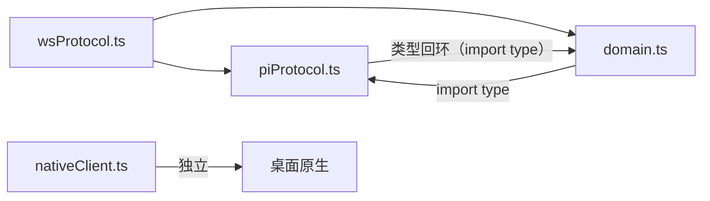
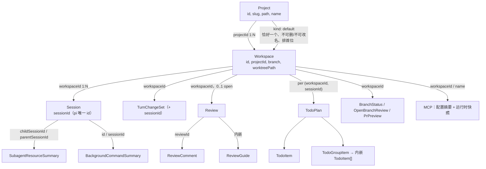
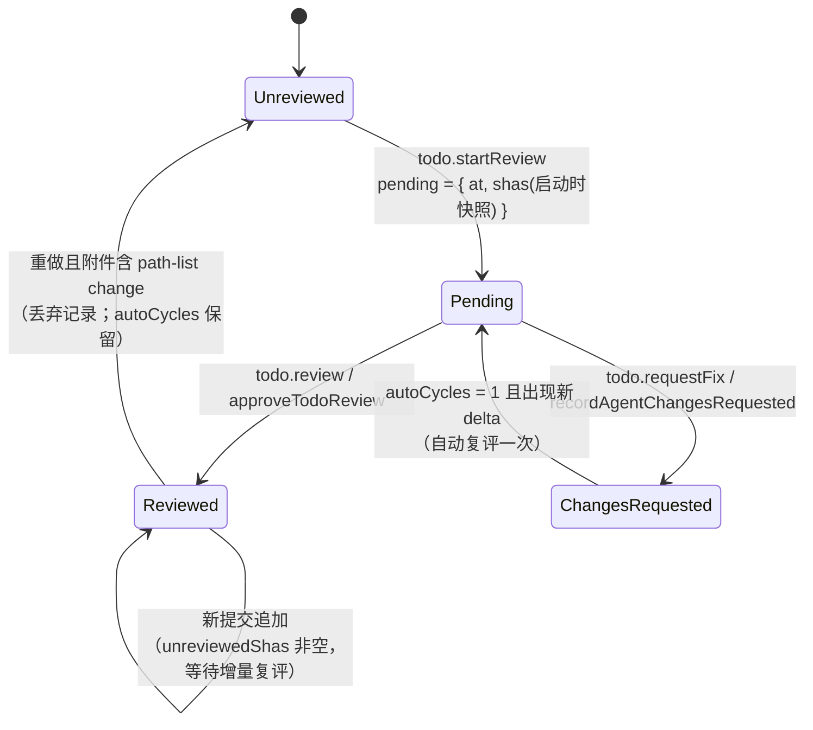
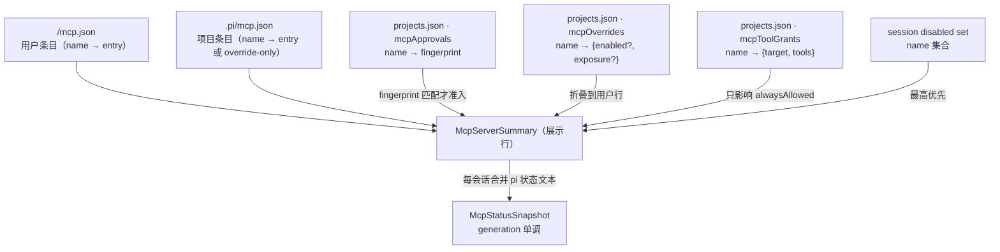
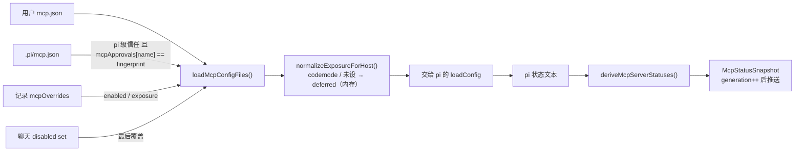

# ThinkRail `contracts` 数据模型关系（完整梳理）

> 范围：`packages/contracts`（engine host ↔ typed wire ↔ web UI 的契约包），以及为解释字段归属而下钻的
> `packages/server/src/{todos,reviews,agent/mcp,projects}`。
> 基线：`PROTOCOL_VERSION = 102`（`packages/contracts/src/wsProtocol.ts`）。
> 生成日期：2026-11-01。所有路径为仓库相对路径，`#Lx-Ly` 指向具体源码区间。

---

## 1. 分层与依赖方向

`contracts` 只有四个源文件：

| 文件 | 职责 | 关键导出 |
|---|---|---|
| `packages/contracts/src/piProtocol.ts` | pi 事件的**线上镜像**：事件、消息、会话快照、模型描述 | `PiEvent`、`WireAgentMessage`、`TranscriptMessage`、`WireModel`、`SessionState`、`SessionSummary` |
| `packages/contracts/src/domain.ts` | 应用实体：项目/工作区/会话记录/TODO/评审/Git/MCP/配置/主题/模板… | `Project`、`Workspace`、`TodoPlan`、`Review`、`McpServerSummary`、`AppConfig` |
| `packages/contracts/src/wsProtocol.ts` | 方法映射、通道、请求/响应/推送信封、版本门禁 | `WS_METHODS`、`WsMethodMap`、`WsRequest`、`WsPush`、`PROTOCOL_VERSION` |
| `packages/contracts/src/nativeClient.ts` | 桌面原生桥（**不属于**宿主 WS 线路） | 原生能力描述 |

依赖关系：



`domain.ts` 需要 `SessionState` / `ThinkingLevel` / `WireModel`（`domain.ts#L1`），
`piProtocol.ts` 需要 `ProviderAuthKind` / `ProviderWarning`（`piProtocol.ts#L19`）。
这是**类型级双向引用**：全部是 `import type`，构建时被擦除，不构成运行时依赖；但两文件必须一起演进。
`wsProtocol.ts` 位于两者之上，是唯一同时使用它们的文件。

---

## 2. 归属主干：Project → Workspace → Session



要点：

1. **唯一 id 模型**：会话身份就是 `session.sessionId`，不存在第二个 pi UUID（架构不变量）。
   `Project.id` 与 `Workspace.id` 各自独立；改名只改 `name`，id/slug/path 不变。
2. **归属被扁平镜像成两份**：
   - `SessionSummary`（`piProtocol.ts#L203-L218`）：读投影，只带 `workspaceId` + 会话元数据（含宿主装饰的 `openTodos`）。
   - `SessionStateRecord`（`domain.ts#L3-L9`）：跨工作区列表用，一次带齐 `{sessionId, workspaceId, projectId}`。
   二者不是嵌套结构，而是同一归属事实的两种扁平视图。
3. **Workspace 的 `kind`**：
   - 缺省 → 宿主管理的 worktree；
   - `"default"` → 项目文件夹本身（每项目恰一个、不可移除/改名、列表首位）；
   - `"external"` → 用户自带、已附加的 worktree（可“忘掉”，不可回收）。
4. **持久记录的位置**（`packages/server/src/projects/SPEC.md`）：
   - `<dataDir>/projects.json`：`Project[]`，含 `mcpApprovals` / `mcpOverrides` / `mcpToolGrants`、技能准入、pi 级信任等；
   - `<dataDir>/workspaces.json`：`Workspace[]`；
   - `dataDir` 由 `persistence.dataDir` 解析（应用状态根，默认 `~/.thinkrail` 语义）。

---

## 3. 一个 Workspace 上并行的六条数据面

这些面**互不嵌套**，只通过 `workspaceId`（有时再加 `sessionId`）关联。

| 面 | 主实体 | 关联键 | 存储归属 |
|---|---|---|---|
| Git / 变更 | `GitDiffScope`、`TurnChangeSet`、`ChangeReceipt`、`GitFileChange` | `workspaceId`（`TurnChangeSet` 另加 `sessionId`） | 宿主内存/回执环；`ChangeReceipt` 每工作区 20 条 / 64 MiB |
| 会话运行时 | `SessionState`、`SessionSummary`、`SessionResources`、`SessionResourceHistory` | `(workspaceId, sessionId)` | pi 上报 + 宿主派生；内存 |
| TODO / 评审 | `TodoPlan` / `TodoGroupItem` / `TodoItem`、`Review` / `ReviewComment` / `ReviewGuide` | TODO：`(workspaceId, sessionId)`；评审：`workspaceId`；评论：`reviewId` | 见 §9、§10 |
| 集成 / PR | `OpenBranchReview`、`BranchStatus`、`PrPreview`、`MergePrResult` | `workspaceId` + `branch` + `number` | 快照 vs 实时事实分离 |
| MCP | `McpServerSummary`、`McpServerStatus`、`McpStatusSnapshot` | 配置层：`(project, name)`；运行层：`(workspaceId, sessionId)` | 三份记录，见 §10 |
| 宿主设置 | `AppConfig`、`FontSettings`、`PiPackagesCatalog`、`ThemePreference` | 全局（`AppConfig` 内可含工作区覆盖） | `<dataDir>` 持久化 |

两个必须分清的“双字段基线”：

- `Workspace.baseBranch` = **创建出处**；`Workspace.diffBase` = **评审目标**。服务端统一解析 `diffBase ?? baseBranch`。
- `Workspace.review` = 宿主缓存的“最近已知评审”快照；`BranchStatus.review` = 每次查询的实时 PR 事实。
  `OpenBranchReview.details` 只随 `workspace.branchStatus` 下发，**永不**进入 `Workspace.review`。

---

## 4. 标识与引用键速查

| 实体 | 主键 / 引用键 | 备注 |
|---|---|---|
| Project | `id`；`slug`、`path`（绝对） | `name` 可改；`path` 用于 `git worktree add` |
| Workspace | `id`；`projectId`；`worktreePath`（绝对） | `baseBranch` / `diffBase` 语义不同 |
| Session | `sessionId`；`workspaceId` | 无第二 id |
| TurnChangeSet | `(workspaceId, sessionId, id)` | base/head 树对 |
| ChangeReceipt | `id`；`workspaceId` | `before/after` = hash + 长度 + mode |
| 后台命令 | `(workspaceId, sessionId, commandId)` | `BackgroundCommandSummary.id` |
| 子代理 | `(workspaceId, parentSessionId, childSessionId)` | `SubagentResourceSummary.childSessionId` |
| 资源目录 | `ResourceRecord = {kind, summary}`；`resourceRecordId()` | `command → id`，`subagent → childSessionId` |
| 资源历史 | `ResourceHistoryCursor {at, id}` | 分页游标 |
| TODO plan | `(workspaceId, sessionId)` → 一个 JSON 文件 | 见 §9.1 |
| TodoItem | `id`（存储项）；adopted 项为 `commit:<sha>` | adopted 只走线，不落盘 |
| TODO review | `(sessionId, todoItemId)` | sidecar |
| Review | `reviewId`；`workspaceId`；`baseSha` | 每工作区 0..1 open |
| ReviewComment | `id`；`reviewId`；`anchor` | `fileSessions` / `doneFiles` 以 path 或 `""` 为键 |
| ReviewGuide | `todoId` + `sessionId` + `reviewedSha` | 内嵌在 `Review.guide` |
| MCP 配置 | `(scope, name)`；`fingerprint` | 见 §10.4 |
| MCP 工具授权 | `project, serverName → {target, tools}` | 只写项目记录 |
| 模型 | `sameModel(a,b)` 只认 `{provider, id}` | 其余字段是可能过期的目录快照 |

---

## 5. 数据归属：同一实体有四种“生命”

| 归属 | 例子 | 规则 |
|---|---|---|
| **持久存储** | `Project`、`Workspace`、`AppConfig`、`Review`（含归档）、`TodoPlan`、`TodoReviewRecord`、`PiPackageSummary` | 宿主磁盘；跨重启 |
| **宿主推导** | `TodoGroupItem.status`、`TodoItem.review`、`TodoPlan.unattributed`、`OpenBranchReview.details`、`SessionResources`、`SessionSummary.openTodos` | 读时/写时现算，形成**唯一真值**；客户端不得重算 |
| **仅线上** | `TodoPlan.adoptedCommits` 的 `TodoItem`（`origin:"adopted"`、`id:"commit:<sha>"`） | 永不写入 agent 的计划文件 |
| **宿主内存、随进程消失** | `ChangeReceipt` 回执环 | 因此有 `RECEIPT_UNKNOWN` |
| **会话内存、随会话消失** | MCP 的 chat-local disabled set（`mcp.setSessionOverride`） | 与 pom 的 “Allow in this chat” 同族 |

`TodoPlan` 是这套模式的教科书：存储项（`todos`/`groups`/`summary`）+ 派生（`unattributed`、组状态）
+ 仅线上（`adoptedCommits`）。详见 §9.2。

---

## 6. 覆盖与有效值解析链

| 有效值 | 解析顺序 |
|---|---|
| `subagentsEnabled` | `Workspace.subagentsOverride` → `AppConfig.subagentsEnabled` |
| `subagentMaxConcurrent` | `Workspace.subagentMaxConcurrentOverride` → `AppConfig.subagentMaxConcurrent` |
| 技能可用集 | `Project.disabledSkills/disabledGroups` 为基线；`Workspace.skillOverrides` 覆盖 |
| 评审目标 | `Workspace.diffBase ?? Workspace.baseBranch` |
| MCP 启用/暴露 | chat-local disabled set → `Project.mcpOverrides` → 文件内值（见 §10.2） |
| `alwaysAllowed` 工具 | 项目记录 `mcpToolGrants`，且 `target` 仍匹配当前生效条目（见 §10.5） |

---

## 7. 线上信封与版本

- **方法侧有完整类型连接**：`WsMethodMap` 的键与 `WS_METHODS` 的值由 `SameUnion` 强制完全一致
  （`wsProtocol.ts#L1239-L1244`）；`WsParams` / `WsResult` 由此派生。
- **请求**：`WsRequest { id, method, params, sessionId? }`（`wsProtocol.ts#L1246-L1251`）。
- **响应**：`WsResponse { id, ok, result?, error?, errorCode? }`（`wsProtocol.ts#L1298-L1304`）。
- **推送**：`WsPush { channel, data: unknown }`（`wsProtocol.ts#L1306-L1309`）。**注意：与请求不同，推送没有类型映射**，
  载荷类型靠各自导出的 payload 别名约定（`SessionCreatedPayload = SessionSummary`、`SessionEventPayload`、
  `ReviewChangedPayload`、`McpStatusPayload`、`TerminalTabsPush` 等）。
- **自定义消息**：`WireCustomMessage<T>` 以 `customType` 为判别字段，配 `details` 形状守卫：
  `ToolResponseMessage`、`SubagentCompletionMessage`、`TodoReviewFixMessage`、`BackgroundCommandCompletionMessage`。
- **事件消息链**：`PiEvent` → 消息统一收窄为 `WireAgentMessage = TranscriptMessage | WireBranchSummary | WireBashExecution`
  （`piProtocol.ts#L328-L349`），pi-agent-core 的原始 `AgentMessage` 不上线路。
- **版本**：`PROTOCOL_VERSION = 102` 只是“当前最新”，每个可选字段绑定自己的 `*_PROTOCOL_VERSION`；
  `server.welcome.protocolVersion` 是唯一握手依据（MCP 方法自 `MCP_PROTOCOL_VERSION = 83` 起，
  `alwaysAllowed` 自 `MCP_TOOL_GRANTS_PROTOCOL_VERSION = 84` 起）。

---

## 8. 结论性不变量

1. **路径拼写有契约**：`Project.path`、`Workspace.worktreePath` 是宿主解析后的绝对路径；
   worktree 相对路径统一 POSIX `/`（`FileNode`、`GitFileChange`、`ReviewAnchor`、`ReviewReadingStep`、
   `WorkspaceFsChangedPayload.paths`）。
2. **一个状态字段只允许一个归属**：`SessionState` 的四件事（`execution`/`runId`、`needsInput`、`completion`、
   `backgroundWork`）正交；`isSessionWorking` 是唯一“是否在工作”判定；`completion` 用稳定 id 做比较并设置/
   `acknowledgeCompletion`，不依赖消息序号。
3. **能算出来的不存**：`Project` 的“有无规格”通过 `project.hasSpecs` 查询；`TodoGroupItem.status`、
   `TodoPlan.unattributed`、`adoptedCommits` 均是宿主现算。
4. **快照 ≠ 实时事实**：`Workspace.review`（缓存）与 `BranchStatus.review`（实时）分离；客户端只能对“同一评审”叠加 `details`。
5. **`pi` 拥有状态**：宿主只暴露 pi 报告的内容，不重算 cost/stats/state。
6. **自动工作结束于 `agent_settled`**，不是 `agent_end`。
7. **`prompt()` 在流式中抛错**，续写用 `steer()` / `followUp()`。

---

## 9. 下钻 A：TODO 计划与计划评审

> 权威 spec：`packages/server/src/todos/SPEC.md`；实现：`packages/server/src/todos/{todos,reviews,baselines,artifacts}.ts`。

### 9.1 三个文件（全部在 worktree 的临时上下文目录）

`WORKSPACE_INTERNAL_DIR = .thinkrail`（`@thinkrail/shared/paths`）。TODO 目录是
`.thinkrail/context/todos/`（`WORKSPACE_TODOS_DIR`）。

| 文件 | 路径 | 写入者 | 结构 | 生命周期 |
|---|---|---|---|---|
| 计划 | `.thinkrail/context/todos/<sessionId>.json` | agent 的 `todo_*` 工具 + 宿主 `todo.add/update/remove` | `pi-todos` 的 `TodoStore` 格式 | 随会话；`session.delete` 删除 |
| 工作窗口基线 | `.thinkrail/context/todos/<sessionId>.baselines.json` | **仅宿主** | `{ version: 1, items: Record<todoId, { paths: string[], head: string \| null, shared?: boolean }> }` | 项消失即剪除；`session.delete` 删整个 sidecar |
| 评审记录 | `.thinkrail/context/todos/<sessionId>.reviews.json` | **仅宿主** | `{ version: 1, items: Record<todoId, TodoReviewRecord>, pending?: Record<todoId,{at,shas?}>, autoCycles?: Record<todoId,number> }` | 同基线；孤儿记录自动失效 |

`workspaceId` 只用于定位 worktree；TODO 的真实作用域是 **`sessionId`**（每个聊天一份计划）。
`TodoStore` 是 pi-free 的读改写实现，因此 agent 的 `todo_*` 写与用户 UI 编辑落在同一文件上，
没有 staleness 窗口。

**为什么评审 sidecar 与计划分离**：agent 重新规划（`todo_write`）不得翻转用户的评审裁决。
计划文件归 agent，基线与评审记录归宿主，这是刻意划出的边界。

### 9.2 `TodoPlan` 的五块内容

| 字段 | 来源 | 语义 |
|---|---|---|
| `todos` | 存储（agent 计划） | 平铺的 `TodoItem[]`；用户新增项打 `origin:"user"`，agent 重规划不丢 |
| `groups` | 存储 + **派生** | `TodoGroupItem` 内嵌 `TodoItem[]`（**不是**按 `groupId` 外键），`status` 由宿主按组内项现算 |
| `summary` | 存储 | 计划级完成说明，agent 通过 `todo_plan_summary` 写；缺失时宿主用 `todo.generateSummary` 兜底 |
| `unattributed` | **每次读取现算** | worktree 中**未提交**、且不属于本计划任何项的变更行；非空才出现 |
| `adoptedCommits` | **每次读取现算，仅线上** | `base..HEAD` 中不属于任何项的提交，包装成 `TodoItem{id:"commit:<sha>", origin:"adopted"}` |

注意 `groups[].todos` 内嵌同一 `TodoItem` 对象，因此一项会同时出现在 `plan.todos` 与某个组里；
客户端不得假设“组内项 = 不在平铺列表”。

### 9.3 工作窗口、提交门与归属

`in_progress` 时宿主**开窗**（`artifacts.ts`，由 `host/server.ts` tee `isTodoToolEnd` 触发）：

- 基线 = 工作区**未提交**变更路径集 + 当前 `HEAD` sha，通过同步 git 叶子函数在 tool-end 发布返回前捕获；
- 基线持久化在 `.baselines.json`，宿主重启不改变归属依据；
- 若另一聊天已开窗，则双方 `shared: true`，且这个标记**粘性**（“整个生命周期是否独占”无法事后推导）。

`done` 时宿主可能提交该步增量，**四条安全门必须全部成立**，否则不提交：

| # | 条件 | 失败时的行为 |
|---|---|---|
| 1 | 存在已记录基线 | `deltaPaths` 为空：不提交、不产生 `change` 工件；脏路径进入 `unattributed` |
| 2 | 基线时的外来脏路径已全部变干净 | 同上（保护 Default 工作区里的用户 WIP） |
| 3 | 窗口从未 `shared`，且此刻没有其他聊天在写 | 同上 |
| 4 | 增量为非空 | 同上 |

通过后：

- `git.gitCommitPaths` 只提交**该步自己的增量路径**（`--no-verify`，作者/提交者保持用户配置）；
- 提交信息是 agent 写的 `commitSubject`（回退 `title`），**单行、无 `todo:` 前缀、无 trailer**；
- 该步得到**一个 `commit` 工件**（sha + label），文件列表**不落盘**，由 `listTodos` 在 `commit:{sha}` 作用域
  现算 `files`（按 `workspace + sha` 内存缓存；不可解析的 sha 则省略 `files`，客户端静默降级）。

**窗口内提交收养（adoption）**：在提交增量前，把 `base.head..HEAD` 中无主提交按时间顺序附到该步。
额外限制：

- 与增量提交共享门 3，且必须记录过 `base.head`；
- 本次 pass 中**同会话只能有一个开着的窗口**——否则较早项的 `base.head..HEAD` 是较晚项的**超集**，
  会贪婪认领后者的提交；此时改为**什么也不收养**，让这些提交降级到安全的 `adoptedCommits`；
- 全 pass 维护 `owned` sha 集，防止重复认领。

重新打开并重做（有新鲜基线）时：新 `commit` **追加**，旧 `change` 路径列表**替换**——工件列表就是该项的
修订历史（1 TODO = N commits 是常态，评审水位线按这个列表求差）。
若新附件里**含任何** path-list `change`，该项的评审记录被丢弃（→ `unreviewed`），因为路径增量没有 sha 可水位化；
若全是 SHA 可证的收养，记录保留。**`autoCycles` 计数单独存放**，不会随记录丢弃而重置。

### 9.4 `unattributed` 与 `adoptedCommits` 的计算

`unattributed`（`unattributedChanges`，纯函数）：

```
未提交 gitStatus 行
  − 应用状态路径（WORKSPACE_INTERNAL_DIR 下，如 todos JSON）
  − 本计划所有项的 change 工件路径
  − 若某窗口开着：该窗口基线的路径集（这些是开窗前就脏的、归属机制永远不能认领的）
```

git 失败 → 省略字段。并发聊天在同一 worktree 的在途工作也会出现在这里（已接受的噪声）。

`adoptedCommits`（`resolveAdoptedCommits`）：

```
git.listCommits(base..HEAD)   // 上限 COMMIT_LIST_MAX = 200
  − 本会话计划所有项 commit 工件的 sha
→ TodoItem { id: "commit:<sha>", origin: "adopted", title: 提交主题, artifacts: [commit] }
```

这些项**从不写入 store**；id 稳定，rebase 掉的提交自然消失，被真实项认领的提交自动退出。
注意上限：超过最新 200 条的提交不会被列出，也不可评审。

### 9.5 评审状态机（人工与 agent 共用）

“可评审”的门是**工件存在**：`done` 且带宿主变更集（`commit` 或 `change`）。研究/验证类步骤不要求评审，
也不做 LLM 归属。

`TodoReviewRecord`（`state ∈ {reviewed, changes_requested}`）：

| 字段 | 含义 |
|---|---|
| `reviewedShas` | **水位线**：评审者真正看过的 sha 集 |
| `reviewedBy` | 缺省人工；`"agent"` 表示 agent 评审 |
| `feedback` | 评审意见/修复要求 |
| `requestId?` | 人工修复请求的不透明 id；补偿时只回滚“仍是当前请求”的那一条 |
| `at` | 记录时间 |

派生到 `TodoItem.review`（`TodoReviewInfo`）：

| DTO 字段 | 来源 |
|---|---|
| `state` | 记录状态；无记录 = `unreviewed` |
| `revision` | 该步 `commit` 工件数 |
| `unreviewedShas` | 当前提交 sha 集 − 水位线（“自评审以来新增”的增量） |
| `feedback` | 记录回显 |
| `reviewing` | sidecar `pending` 存在 |



关键点：

- **水位线优先用启动时快照**：`startTodoReview` 把启动时的 sha 列表写进 `pending.shas`；
  `approveTodoReview` / `recordAgentChangesRequested` 优先用它，而不是“当下 shas”。
  这样评审者流式回合期间 worker 新落的提交保持为未评审增量，不会被静默标记为已读。
- **写入是全快照单次提交**：record + `autoCycles` + 清 `pending` 一次写入（`commitReviewTransition`），
  避免“已 changes_requested、周期已用尽、pending 还在”的破碎状态。
- **开机清理**：`pending` 只在内存中有意义，宿主重启会残留 spinner；
  `clearAllPendingReviews(root)` 在每个工作区启动时无条件清空所有 `pending`，但不动评审记录本身。
- **`reviewing` 与 `state` 正交**：pending 是“正在评审”，record 是“上一次裁决”。

### 9.6 agent 评审与自动修复

- `todo.startReview` / worker 自己的 `request_review` → 启动一个**隐藏、短暂**的评审子代理
  （计划会话的 delegation child）。不存 `reviewerSessionId`，没有评审聊天。
- 评审者把发现写成 `ReviewComment{author:"agent"}`，进入 `reviews` 模块的同一存储（§9.7），
  而不是另一套并行存储。
- 自动周期：`autoCycles` 0 → 1 时把发现自动发给 worker；修复后的新 delta 自动复评一次；
  第二次裁决记 `autoCycles = 2` 并终止，交给人。
  `reviewAutoFix` 关闭时短路：裁决直接记 `autoCycles = 2`，不发送，发现等待人工。
- `todo.reviewAll` 是纯宿主编排：对计划上每个未决可评审项依次走同一流程（`host/planReviewQueue.ts` 串行），
  本身不新增状态。

**人工修复的投递**（`todo.requestFix`）：

1. `todos` 记录 `changes_requested` + feedback + 水位线，并渲染 **fix package**（步骤标题/备注、完成摘要、
   变更集**引用**（短 sha / 路径，绝不整份 diff）、逐字反馈、“重新打开这一项”的指令）；
2. `host` 组合发送：`AgentSession.sendCustomMessage`，`customType: "todo-review-fix"`，
   `content` = package 文本，`details` = `ReviewFixDetails`（卡片渲染用），
   `deliverAs:"followUp"` + `triggerTurn`（不是合成用户回合）；
3. 预回合被拒绝（模型/密钥问题）→ `rollbackTodoFix` 恢复被替换的记录并显示扩展 UI 通知，
   使未送达的修复请求不会永久停在 `changes_requested`；
4. 修复落在**该步自己的聊天**（per-session 计划/窗口强制如此）。

### 9.7 与 Changes 面板评审（`Review`）的连接

两者共享**评论**这一底层实体，但存储不同：

| 维度 | TODO 评审 | Changes 评审 |
|---|---|---|
| 存储 | `<worktree>/.thinkrail/context/todos/<sessionId>.reviews.json` | `<dataDir>/reviews/<workspaceId>.json` + 归档 |
| 粒度 | 每个 `TodoItem` 一条裁决 | 每条评论一个 `ReviewComment`，按文件/整体聚合成聊天 |
| 发现 | 评审者的 `ReviewComment{author:"agent"}` 落在 `reviews` 存储，经 `ReviewGuide`（`todoId+sessionId+reviewedSha`）关联计划项 | 同一 `ReviewComment` 模型 |
| 发送 | `todo-review-fix` 自定义消息 | `review.sendComment` / `review.sendBatch` 的 package |

`ReviewGuide` 内嵌在 `Review.guide`，由宿主的“裁决记录器”写入（客户端不能写），
随 `review.changed` 快照广播，让 Changes 评审页无需二次读取就能按建议阅读顺序走查。

### 9.8 Changes 评审的完整生命周期（补充）

- **每工作区 0..1 个 open `Review`**，首次读取/评论时**惰性创建**（单飞，避免并发创建互相覆盖）。
- `baseSha` = 分支范围的**分叉点**（`merge-base(diffTarget, HEAD)` 的完整 oid），创建时钉住、不可变；
  与 Changes 面板当前 scope 无关（切换 scope 不改变“评审是什么”）。
- `Review.fileSessions`：每个评审 KEY → 一个聊天 sessionId；KEY 是评论的 `path`，
  或**空字符串**（`REVIEW_LEVEL_KEY`，整体变更集评论）。首次发送创建聊天，后续发送 follow-up 进同一聊天。
- `Review.doneFiles`：同 KEY 集合，标记“这个文件看完了”；文件上出现新评论会清除标记并重新打开。
- 评论状态：`draft → sent → resolved | dismissed`。
  - 只有 `draft` 可删除；
  - `draft ↔ sent` **只由发送路径**（`markCommentsSent` / `rollbackSend`）驱动，客户端不能“反发送”；
  - `review.commentUpdate` 只能落终态（resolved/dismissed）；
  - `review.close` = Clear：先把非草稿记录归档到 `reviews/archive/<workspaceId>/<reviewId>.json`，
    再用全新 open review 替换并只广播新快照（草稿丢弃）。
- **发送顺序**（每工作区与所有评审变更串行）：重锚 → 渲染 package → 创建/续接聊天 → `markSent` → 发送 prompt（分离执行）。
  预回合拒绝 → `rollbackSend` 退回 `draft`。
- **重锚**（`reanchorWorkspace`，每次快照读取与发送前）：
  1. `contentHash` 未变 → `anchored`；
  2. 用 `textQuote.exact`（prefix/suffix 消歧）唯一匹配 → 更新 `lineRange`，`moved`（**粘性**，刷新 hash 也不降级）；
  3. 无匹配/歧义/文件消失 → `outdated`（保留创建时快照，仍可发送）；
  4. 没有 `textQuote` 的字节型资源：有定位选择器（`lineRange`/`structural`/`region`）→ `outdated`；
     整文件级评论（无选择器）→ `moved` + 刷新 hash。
  `side:"base"` 锚点**永不重锚**：`baseRef` 是 commit oid，blob 不可变；用 worktree 重锚正是逐侧捕获要防的“重指向”。
- **agent 解析评论**：`resolve_comment` 是 agent 模块的自定义工具，按 `ctx.sessionManager.getSessionId()` 回传；
  只允许解析 `status === "sent"` 且 `sessionId` 等于调用者的评论（外加 `author:"agent"` 的草稿），
  人工草稿永不可被 agent 解析。Clear 之后到达的解析更新归档记录、不广播。

---

## 10. 下钻 B：MCP 的三份记录

> 权威 spec：`packages/server/src/agent/mcp/SPEC.md`、`packages/server/src/host/SPEC.md`、
> `packages/server/src/projects/SPEC.md`。

MCP 的数据模型不是“一份配置”，而是**三份记录 + 一份运行时快照**：

| # | 记录 | 物理位置 | 拥有者 | 回答的问题 |
|---|---|---|---|---|
| 1 | 配置文件 | 用户级 `<agentDir>/mcp.json`；项目级 `<worktree>/.pi/mcp.json` | 用户 / 仓库 | “定义了哪些服务器” |
| 2 | 项目记录 | `<dataDir>/projects.json` 的 `mcpApprovals` / `mcpOverrides` / `mcpToolGrants` | 宿主（用户本机） | “我批准/覆盖/授权了什么” |
| 3 | 聊天本地 disabled set | 会话内存（`mcpSessions` 的 tracked 对象） | 宿主运行时 | “这个聊天临时关掉了什么” |
| 4 | 运行时快照 | 内存，`McpStatusSnapshot` + 单调 `generation` | pi 上报 + 宿主派生 | “此刻连上了什么” |

### 10.1 三份记录的字段关系



字段对应：

- `McpServerSummary.approval`：`{state:"approved"|"pending"|"changed", fingerprint}`。
  项目行 = `Project.mcpApprovals[name]` 与当前指纹比较；用户行没有批准概念。
- `McpServerSummary.projectOverride`：`Project.mcpOverrides[name]` 的回显。
- `McpServerSummary.replacesGlobal`：项目条目同名遮蔽用户条目（override-only 条目则反过来折叠进用户行）。
- `McpServerSummary.alwaysAllowed`：`mcpToolGrants[name].tools` 中 `target` 仍匹配当前生效条目的那些。
- `McpServerSummary.effective` / `effectiveExposure`：叠加记录覆盖与已准入的仓库覆盖后的最终结果。
- `McpServerSummary.configError`：pi 等价校验错误（经 `redactMcpText` 脱敏）。
- `McpServerStatus.state` 的取值来源见 §10.6。

### 10.2 加载/准入管线（每个会话、每次重载）



规则：

1. **项目文件只在项目可信时加载**；但 pi 级信任**本身不启用 MCP**——项目条目仍需 `mcpApprovals` 指纹匹配。
2. 未批准的项目覆盖条目**不生效**，用户级服务器保持原样。
3. `mcpOverrides` 只作用于**用户级**服务器（项目级服务器的启用/暴露写在项目文件里）。
4. 聊天 disabled set 拥有最高优先级。
5. exposure 归一化只在内存：`codemode` / 未设 → `deferred`（因为 ThinkRail 不交付 codemode）。
6. 扩展用 `pi.registerMcpServer()` 注册的服务器走另一条路：`registered: true`，
   **不能按聊天禁用**，且 `handledElsewhere` 时 `mcp.*` 写入必须失败（`MCP_HANDLED_ELSEWHERE`）。

### 10.3 读写矩阵

| 方法 | 写 `projects.json` | 写 `mcp.json`（用户） | 写 `.pi/mcp.json`（项目） | 仅内存 / pi | 读依据 | 主要失败 |
|---|---|---|---|---|---|---|
| `mcp.list` | — | — | — | — | 两份文件 + 记录 + pi 状态 | — |
| `mcp.add` | 项目作用域时写批准指纹 | 用户作用域：是 | 项目作用域：是 | 触发热重载 | 目标文件 `mcpServers` 中名字须**不作为自有属性存在** | `MCP_CONFIG_INVALID`、`MCP_PATH_UNSAFE`、`MCP_HANDLED_ELSEWHERE` |
| `mcp.update` | 仅当记录里已批准的指纹 == 磁盘指纹时，把批准抬到新指纹 | 用户作用域：是 | 项目作用域：是 | 触发热重载 | `renderedTarget.expectedFingerprint` 与作用域文件磁盘条目比较并交换 | 同上（指纹不符 → 文件不动） |
| `mcp.remove` | —（批准记录保留；条目消失即不生效） | 用户作用域：是 | 项目作用域：是 | 触发热重载 | 同上 `expectedFingerprint` | 同上 |
| `mcp.setProjectOverride` | **是**（`mcpOverrides` 原子合并） | — | — | 触发该项目的重载对账 | 最新记录；只接受 `enabled:boolean` 与 `exposure ∈ deferred/direct/hidden` | `MCP_CONFIG_INVALID` |
| `mcp.setSessionOverride` | — | — | — | **是**（聊天 disabled set，随会话消失） | 会话必须属于命名工作区 | `MCP_CONFIG_INVALID` |
| `mcp.approve` | **是**（`mcpApprovals[name] = fingerprint`） | — | — | 触发重载 | 当前磁盘指纹必须等于请求指纹 | `MCP_CONFIG_INVALID` |
| `mcp.revokeToolGrant` | **是**（从 `mcpToolGrants` 移除一个工具；空了就删字段） | — | — | 不重载聊天（调用守卫实时读授权） | 项目记录 | `MCP_CONFIG_INVALID` |
| `mcp.shareWithRepo` | 写批准指纹 + **清除** `mcpOverrides[name]` | — | **是**（把记录覆盖写成 pi 的 override 条目） | 触发重载 | 用户级定义仍存在；项目文件不含该名字的普通条目；已有 override 必须已按当前指纹批准 | `MCP_CONFIG_INVALID`、`MCP_PATH_UNSAFE` |
| `mcp.login` | — | — | — | pi OAuth 探测；`loginId` 归调用者 `clientKey` | 当前信任 + 策略解析出的有效服务器 | `MCP_HANDLED_ELSEWHERE`、`LOGIN_NOT_OWNER` |
| `mcp.logout` | — | — | — | await 同属主的探测 | 同上 | 同上 |
| `mcp.testConnection` | — | — | — | pi 探测；要求准入配置为 HTTP | 同上 | 同上 |
| `mcp.reconnect` | — | — | — | pi 运行时重连 + 刷新该聊天状态 | 会话属于命名工作区 | `MCP_CONFIG_INVALID` |
| `mcp.readOutput` | — | — | — | 读 pi 的工具输出缓冲 | 仅该工作区的会话 | — |
| `mcp.readLog` | — | — | — | 读 `<agentDir>/mcp.log` | 服务器名按 pi 字符集校验 | — |

补充：

- **所有写操作共用的前置**：项目级写入需要 **pi 级信任**（否则 `MCP_CONFIG_INVALID`）；
  项目路径必须是 worktree 内**真实目录 + 普通文件**，不允许符号链接（`MCP_PATH_UNSAFE`）。
- **写后对账是“启动而非 await”**：请求立刻用新列表作答，受影响的活会话逐个重载，
  只有“有效配置确实变了”的聊天才重载，每次重载通过 `mcp.status` 推送报告。
- **探测帧只发给发起连接的 socket**，不广播；外来 `loginReply/loginCancel` → `LOGIN_NOT_OWNER`。

### 10.4 fingerprint：为什么一次编辑会让批准失效

`fingerprintMcpEntry(name, raw)`（`config.ts`）：

```
sha256(`${name}:${canonicalJson(raw)}`)
```

- 哈希对象是**定义文件里“原样写下的整个条目”**，不是解析/合并后的有效值；
- 规范化 JSON：键递归排序，**唯一例外是 `toolExposure` 的键序有语义**；
- 名字参与哈希：改名即换指纹；
- 前导 UTF-8 BOM 在读取、写入、指纹计算中被一致忽略；一次成功编辑会写出无 BOM 的普通 JSON。

因此：

- `mcp.approve` 传入的指纹必须等于**当前磁盘**条目指纹，否则拒绝；
- `mcp.update` / `mcp.remove` 必须先拿到磁盘指纹做比较并交换，客户端不能“凭旧视图”改写；
- 仓库侧改动（例如重新 checkout 出不同条目）会让旧批准变为 `pending` / `changed`；
- 重新出现的**完全相同**条目会重新匹配旧批准——批准是按 `name → fingerprint` 的持久事实，
  不是一次性令牌。

### 10.5 同名合并、覆盖折叠与工具授权

- **项目条目遮蔽用户条目**：`replacesGlobal = true`，展示行取项目定义；
  未批准的项目条目不被准入，用户定义继续生效。
- **项目文件里的 override-only 条目**（只有 `enabled`/`exposure`/`toolExposure`，且用户级存在同名服务器）：
  不单独成行，而是**折叠进用户级服务器行**，`scope: "global"` + 一个 `override` 路径。
  它与记录里的 `mcpOverrides` 语义相同，但来源是仓库（因此也要指纹批准）。
- **`effective`**：该行是否是“被准入的有效定义”；`effectiveExposure`：叠加所有覆盖后的实际暴露级别。
- **工具授权**（`mcpToolGrants[name] = { target, tools }`）：
  - `target = sha256(生效条目的 command + args，或 url，按原样)`；
  - 只有 `target` 仍匹配时才计入 `alwaysAllowed`；
  - 改 env/header/exposure **不会**撤销授权；改 command 或 URL **会**（要求重新询问）；
  - 工具名用 **pi 的 tool 名**（`mcp__<server>__<tool>`），因为守卫只看得到这个名字；
  - 授权只存项目记录，**绝不写入 `.pi/mcp.json`**——否则仓库可以自带“已授权”。
- `sessionHost.ts` 的调用守卫（每个父会话一个，子会话没有）：
  跳过 `readOnlyHint: true` 的工具；聊天内允许或持有有效项目授权的直接放行；
  否则弹 **Deny · Allow once · Allow in this chat · Always allow**。
  “Allow in this chat”只存在于宿主对象，资源重载后仍在，会话结束即消失。

### 10.6 运行时快照与 `generation`

`McpStatusSnapshot { workspaceId, sessionId, generation, servers: McpServerStatus[] }`：

- **配置层**（`McpServerSummary`）是会话无关的列表；
- **运行层**（`McpServerStatus`）按会话下发：`state`、`toolCount?`、`detail?`（已脱敏）、`updatedAt`；
- `state` 由谁判定：
  - `connected` / `disconnected` / `pending-reload` / `not-running`：pi 状态文本 + 宿主重载状态；
  - `disabled` / `disabled-in-project` / `disabled-in-chat`：配置/记录/聊天 disabled set；
  - `pending-approval` / `invalid-config`：摘要派生；
  - `handled-elsewhere`：MCP 由另一管理器接管；
  - `unknown`：无法解析。
- `generation` 每会话单调递增；推送消费方按它丢弃旧快照。会话重载会重建快照。

`detail` 的脱敏发生在**进入 DTO 之前**：pi 不脱敏（连接错误、HTTP body 片段、stdio stderr 尾部最多 2000 字符），
宿主用 `redactMcpText` 做确定性、幂等掩码，`maskMcpEndpoint` 负责命令行形式。

---

## 11. 附录：方法 → DTO → 存储 速查

| 领域 | 方法（前缀） | 主要结果 DTO | 主要存储 |
|---|---|---|---|
| 项目/工作区 | `project.*`、`workspace.*` | `Project`、`Workspace`、`BranchStatus` | `projects.json`、`workspaces.json`、git |
| 会话 | `session.*`、`agent.*` | `SessionSummary`、`SessionState`、`SessionResources` | pi + 内存 |
| 聊天 | `chat.*` | `PiEvent`、`TranscriptMessage` | pi transcript |
| TODO | `todo.list/add/update/remove/review/requestFix/startReview/reviewAll/generateSummary` | `TodoPlan` / `TodoItem` / `TodoReviewInfo` | todos JSON + 两个 sidecar |
| Changes 评审 | `review.get/commentAdd/commentUpdate/commentDelete/fileDone/sendComment/sendBatch/close` | `ReviewSnapshot` / `Review` / `ReviewComment` | `reviews/<ws>.json` + archive |
| Git/变更 | `git.*`、`changes.*`、`turns.*` | `GitDiffScope`、`TurnChangeSet`、`ChangeReceipt` | git + 内存回执 |
| MCP | `mcp.*`（15 个） | `McpServerSummary`、`McpStatusSnapshot`、`McpListResult` | 两份 mcp.json + 项目记录 + 内存 |
| 分支评审/PR | `branchReview.*`、`pr.*` | `OpenBranchReview`、`PrPreview`、`MergePrResult` | GitHub + 缓存 |
| 设置 | `settings.*`、`theme.*`、`font.*`、`extensions.*`、`piPackages.*` | `AppConfig`、`PiPackagesCatalog` | `<dataDir>` |
| 主题/模板 | `theme.*`、`template.*` | `ThemePreference`、模板记录 | `<dataDir>` + 文件 |

推送通道（`WS_CHANNELS`，`wsProtocol.ts#L414-L444`）中与本文最相关的：

- `session.event`：`PiEvent` 流，驱动 TODO 刷新与评审增量；
- `session.created` / `session.stateChanged` / `session.resourcesChanged`：会话与资源目录失效；
- `review.changed`：完整 `Review` 快照（幂等，客户端折叠）；
- `mcp.status`：`McpStatusSnapshot`（带 `generation`）；
- `workspace.branchStatus`：含 `OpenBranchReview.details` 的实时 PR 事实。

---

## 12. 已知限制与刻意取舍

1. **TODO 不推送**：用户编辑不广播；操作端乐观更新，另一客户端靠下一次 `pi.event` 触发的重取。
   单宿主、单主聊天的场景下可接受。
2. **提交归属只对“独占、单项、有 `base.head`”的窗口成立**：共享窗口、缺基线、无出生 HEAD、
   同会话第二个窗口开着，都会让窗口内提交降级为 `adoptedCommits`。
3. **`adoptedCommits` 枚举上限 200**：超过 `COMMIT_LIST_MAX` 的旧提交既不展示也不可评审。
4. **提交不可变，自动修复无法自愈被标记的 adopted 提交**：修复会以新 `sha` 成为新的 adopted 条目；
   `maybeAutoReReview` 刻意排除 adopted。
5. **跨会话噪声**：别的会话的计划项拥有的提交会出现在本会话的 `adoptedCommits`；
   同一 worktree 里并发聊天的在途工作会出现在 `unattributed`。均为已接受。
6. **Changes 评审的状态只靠推送收敛**，不做乐观更新；`Clear` 只广播新 open 快照，
   客户端永远不会看到中间态归档副本。
7. **Review 的 `baseSha` 一旦钉住不可变**：评审目标中途可重指、分支可移动，但“这次评审是什么”不变。
8. **MCP 探测/登录帧只发给发起方**；跨 socket 回复一律 `LOGIN_NOT_OWNER`。
9. **MCP 授权与配置分离**：授权只在项目记录，仓库文件永远不能自带授权；
   `shareWithRepo` 是把本机记录“提案”进仓库的显式动作，并把记录覆盖清空。
10. **`generation` 是运行层唯一的防旧机制**：任何新快照必须递增，客户端必须按它丢弃旧值。
