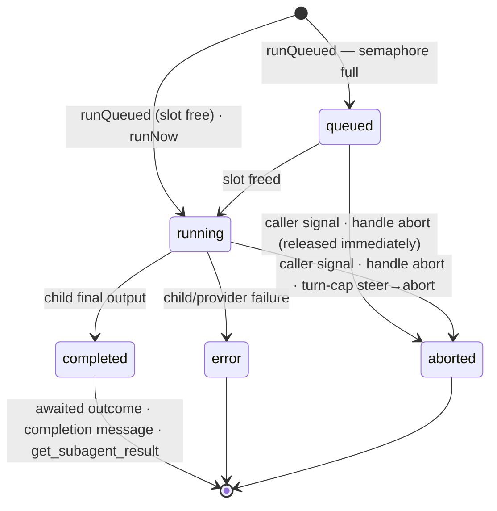

# pi-delegation —— 会话织层（可移植的委托核心）

> 中文译文，原文见 [`SPEC.md`](./SPEC.md)。英文原文是唯一权威来源，二者不一致时以原文为准。

## 职责（Responsibility）

`pi-delegation` 是**可移植的、纯 pi 的委托核心**：为受控子会话提供织层，这些子会话
由活动的父会话或独立资源拥有。一个创建原语（`createChild`）配以正交的轴；
一个拥有运行循环的句柄（按父级的 FIFO 配速、轮次上限、用量聚合）；以血缘作为存储布局；
一个内存中的运行 registry；以及生命周期事件。契约本身住在 barrel 上
（`src/types.ts`，每个类型都在原地有文档）；本规格记录语义、边界与决策日志。

会话父级路径支持隐藏的、非交互式子会话，使用显式的 `SessionOptions`，
由 [[module-pi-subagents]] 消费。已批准的资源扩展在 fresh 来源之外增加了资源所有者与
`fork-captured` 历史，使用同一套装配与运行所有者。其他预声明组合仍然被**大声拒绝**，
带类型的 `DelegationError`（见下文的作用域与就绪规则）。

## 批准的、资源拥有的扩展（Approved resource-owned extension）

持久 DAG 消费者 [[module-pi-dag]] 在会话父级之外增加一个独立的资源所有者。
资源子会话不需要哑父会话，也不需要实时父级查找。这修订了仅父级的工作流假设以及下文
决策 #9，以适配这条额外的所有权路径；既有的父级 API、默认值、收集、事件与级联保持其语义。
该扩展已实现；下文仅父级的描述继续记录会话父级路径。

服务暴露 `registerResource` 和与 provider 无关的 `captureHistory`。资源句柄拥有准备好的
执行上下文、本地并发与精选工厂；它们暴露 `validateModels`、`createChild`、`reopenChild`
和 `release`。子会话句柄暴露身份/记录、`runQueued`、字面的仅活动 `steer`、`abort` 和
`dispose`，而不是原始会话或第二运行循环。`resolveParent` 对纯资源构造是可选的。
release 会结算待处理的装配/子会话/扩展，且绝不处置外部借用的运行时或不相关的
父级拥有的子会话。

捕获接受一个受信的只读 pi manager（带显式的条目/工具批次前切点），或一个已结算的
已存储资源子会话（带其保存的边界）。它返回规范的 branch JSONL 外加身份、边界、摘要与大小。
消费者保留字节；核心校验/捕获/fork 而不另设历史库。`fork-captured` 增加不可变输入，
而既有的实时源 fork/种子化占位仍然被拒绝。空切点是显式的，工具不完整/损坏的捕获失败，
压缩与标签被保留，源历史永不被修改。资源会话记录查找是严格的，由捕获/reopen 共享，
而不是任意的文件导入器。

`reopenChild` 消费保存的不可变出生记录（不包括其路径），外加保存的声明式会话配置。
它校验所有者/作用域/文件身份并保留出生元数据，只解析一条新的访问路径。
缺失的文件绝不创建替代会话。崩溃悬挂的最后一个工具批次在 pi 重放之前获得通用错误结果；
非尾部或畸形的缺口按失败关闭处理，因为任何基于位置的修复都不安全。
fork 装配会把实际模型和 pi 钳制的 thinking 持久化进子会话分支；源元数据/全局默认值保持不变。
Pi 在 reopen 时重载选择加入的资源；保存的配置不是冻结的渲染后提示词。

`RunOutcome` 增加调用本地的 `stopReason` 与终态 `historyEntryId`。定稿消息的观察能在压缩后
继续存在；用量仍然是 pi 统计值的增量。资源提示词绕过命令与 skill/模板展开。
资源 steering 通过 pi 的队列同步地只针对活动调用；入队不是消费。
取消覆盖预检/排队中的工作，并在准入另一次运行之前清理残留队列。
所有结算都留在既有的运行所有者内部。

提供运行时的所有者为其生命周期作保；基于 registry 的保留复用不透明 provider 重放，
而不重载源扩展、也不从后续聊天重新同步。缺失模型或不支持的仅运行时鉴权路径会显式失败，
而不是替换。两类被保留的对象都不是凭据快照，也不是所有权租约。
回归覆盖必须包括源聊天处置之后创建子会话、父级行为不变，以及零 worker 保留。

### 资源实现决策与验证（Resource implementation decisions and verification）

- 资源会话记录使用 `<delegationRoot>/<scope>/.resources/<resourceId>/<pi-file>.jsonl`。
  作用域/资源/会话片段都经校验；捕获与 reopen 共享一个身份校验的定位器，
  它会拒绝歧义文件、符号链接、非普通文件与畸形的 v3 历史。reopen 从不使用调用方提供的
  路径、从不制造缺失的会话记录，并把保存的出生记录当作 pi 头部中不存在的委托元数据的权威。
  它只在构造会话之前修复活动尾部上可安全重放的缺失结果。
- 注册立即保留该身份、在返回之前准备好上下文，且不创建会话。重复注册失败于
  `resource-exists`。生效的模型引用必须精确解析（`model-unavailable`）；
  资源创建绝不回退到任意的 SDK 模型。registry 输入一次性重放不透明的已配置/原生
  provider 注册，而不重跑源扩展。公开的鉴权来源元数据能检测仅运行时凭据与不可用的
  存储鉴权重放（`unsupported-auth`），而不提取机密。这一静态检查无法为不透明的
  provider 私有状态或将来的远程鉴权作保。
- 资源并发默认取服务的父级上限（未另行绑定时为 4），每个资源有独立的 FIFO 槽位。
  资源本地工厂在服务的精选集合之上增补；既有的 `session.extensions` 选择加入与工具
  允许列表仍然适用。资源句柄与记录绝不出现在父级查找、收集、事件或处置级联中。
  子会话规格、模型引用与嵌套配置在准入可以 await 之前就被分离；记录及其 `info` 值是
  冻结副本。
- release 同步关闭所有准入、在 await 任何清理之前先给每个子会话发信号、结算在途装配、
  发出/await 每个资源子会话的 `session_shutdown`、处置会话，然后移除注册/上下文/配速引用。
  并发的 release/dispose 共享既有的结算 promise；借用的运行时绝不被处置。
- 捕获序列化一个 v3 头部和恰好选定的祖先路径。`null` 是显式的空分支
  （`[]`，而非 `getBranch(null)`）。校验检查身份、形状、祖先关系、切点、
  SHA-256/UTF-8 长度、当前 v3 的系统/用量/上下文编辑记录与压缩引用，
  包括 retain-none 压缩与标签条目。Pi 的公开 `buildSessionContext` 提供压缩感知的重放；
  `scanReplayTools` 提供工具闭包检查以及宿主修复路径不变的保守尾部修复候选。
  失败与中止的 assistant 尝试不会伪造缺失的成功结果。捕获从不修复。
  已存储的捕获直接读取已校验字节，不调用任何运行时或可变的 SDK 文件打开。
- fork 使用带原生 `SessionManager.forkFrom` 的内部私有临时种子，在任一结果上清理该种子。
  在改变提示词、工具或模型之前，子会话追加上下文编辑，隐藏 Anthropic/Claude 签名或
  打码的 thinking：那些签名绑定前序前缀，无法移植到新子会话。规范化的已捕获字节与原始条目
  保持不变；未签名与其他 provider 的推理仍可见。实际子会话模型与其被钳制的 thinking
  变化被追加，而不改变源历史或全局设置。已捕获的字符串是消费者保留的不可变输入，
  不是核心历史库。捕获会物化该分支；在这个有界的扩展中不新增字节配额。
  准入上限策略仍是后续工作。
- 资源提示词预检使用字面的扩展源输入；受守卫的 steering 同步调用公开的
  `session.agent.steer`，用户消息不变。在预检期间被取消的运行对应的提示词，
  会被每个子会话在自身扩展之后加载的内部 `input` 处理器丢弃，因此用户消息永不被写入，
  也不发出任何请求；对剩余窗口在 agent 启动时重新施加取消。Pi 1.2 从
  `before_agent_start` 起就把会话计为忙碌，并在该忙碌区间内运行 `preflightResult`，
  因此从它抛出（1.2 之前的机制）会让子会话永远忙碌。队列在取消之前被清空，
  并在另一次运行的结算/准入之前再次清空。资源句柄上的 `abort()` await 该调用的完整结算，
  包括排队中的工作。
- `RunOutcome.stopReason` 与最终文本是该调用中最后一次定稿的 assistant 观察，
  在重试/压缩之间保留；取消意图不能覆盖该停止证据。用量仍是 pi 累计统计的增量。
  `historyEntryId` 是结算后的叶子，包括元数据/压缩条目，不是成功完成的证明。

回归套件只使用本地合成 provider。它们覆盖父级兼容性与已捕获的父级 fork；
零 worker/借用/registry/原生 provider 保留；带崩溃尾部修复与非尾部拒绝的严格存储式
捕获/reopen；规范切点、当前 v3 条目、摘要/闭包/压缩校验；带 provider 绑定的 thinking
净化的源独立扇出；分离的准入输入；资源本地工厂与 FIFO 隔离；字面 steering 与过期队列清理；
排队/预检取消；待处理装配/关闭的释放屏障；以及压缩收缩之后的定稿结果。

## 公开接口：barrel，`index.ts`（Public surface (the barrel, `index.ts`)）

- `createDelegationService(bindings)` —— 服务（`DelegationService`）：`createChild` /
  `setMaxConcurrentPerParent` / `findChild` / `childrenOf` / `onLifecycle` /
  `disposeChildrenOf`，外加 `registerResource` / `captureHistory`。资源、出生与已捕获历史
  的契约类型从实际的包 barrel 导出。`scanReplayTools` 是供捕获与宿主会话记录修复共享的
  纯重放扫描器；修复策略与合成工具结果仍归宿主所有。
- `DelegationBindings` —— 一切宿主相关的东西：`resolveParent`（对纯资源服务可选；
  父级创建需要它且需要活的返回值；返回 `ParentContext` ——
  `Pick<ExtensionContext, "cwd" | "model" | "thinkingLevel">` 外加可选的
  `isProjectTrusted`、`modelRuntime` 与 `modelRegistry` 字段。`isProjectTrusted` 是
  子会话的 settings manager 所接受的 pi 级项目信任（在创建时询问，并在下文的重新校验时
  再次询问）：信任是子会话从父级派生的上下文的一部分，因此子会话加载的项目范围
  绝不比父级更多 —— 纯 pi 的 `ctx` 携带会话自身的信任，ThinkRail 则回答其父级的
  已加载信任 AND 当前的 `Project.piResourceTrust`；缺失 → 受信，即 pi 自己
  `SettingsManager` 的默认值。资源上下文（`ResourceContextInput`）接受同样的可选字段。
  父级自身保留的 `modelRuntime` 优先于所有回退：一个让每个会话都保留其创建时运行时世代
  的嵌入方（ThinkRail）必须把*父级的*世代交给子会话，否则一个在断连后仍靠 Central-only
  模型存活的父级会委托到缺少其 provider 的运行时里（PR #303 评审后续）。
  `modelRegistry` 是公开的纯 pi 兼容路径：当父级与服务运行时都未绑定时，核心在每次解析
  子会话之前把其不透明的扩展 provider 注册镜像进自建的运行时，包括移除已消失的注册。
  ThinkRail 投影 manager 的实时会话（含条目的世代运行时）；纯 pi 传入扩展自己的 `ctx`，
  包括其 registry）、`delegationRoot`、`scope`、
  `modelRuntime`（一个 `ModelRuntime` 值**或一个活的 provider**
  `() => ModelRuntime | Promise<ModelRuntime>`，**按每次 `createChild`** 解析：
  嵌入方的运行时可以是世代化的 —— ThinkRail 在 Central 连接/断开时切换运行时世代 ——
  而在服务创建时捕获的值会把后续每个子会话钉在第一个世代上，而新的父聊天却继续前进
  （PR #303 评审发现）；缺失 → 服务**每个父血缘**自建一个运行时，并缓存到
  `disposeChildrenOf(parent)` 为止 —— 一个服务可能解析来自不同 registry 的父级，
  因此单一可变回退绝不能跨它们同步 provider 状态）、
  `maxConcurrentPerParent`、`childBaseExtensionFactories`（每个子会话都加载的、
  仅钩子的集合）与 `childExtensionFactories`（子会话**可以**加载的精选集合）——
  两者都是决策 #25，都是 pi 的 `InlineExtension`，因此嵌入方可以传入裸工厂或
  `{ name, factory }`，并把名字留在 pi 诊断里 —— 以及 `buildChildSettings`（决策 #31）。
- 存储辅助函数：`defaultDelegationRoot` / `delegationSessionDir` / `deriveChildSessionFile`
  （重启后的会话记录读取）/ `DEFAULT_SCOPE`。
- 契约类型本身（含 `DelegationError`/`DelegationErrorCode`）—— 在 `src/types.ts` 中
  枚举并有原地文档，此处不重述。

## 边界（Boundary）

- **允许的依赖：** pi SDK（`@earendil-works/pi-coding-agent`、`@earendil-works/pi-ai`）
  作为 **peerDependencies** —— 由加载它的运行时提供；`node:*`。
- **禁止：** 任何 `@thinkrail/*` 包（本包必须在原版 pi 下可用）；
  `@earendil-works/pi-tui`（设计上无头 —— 渲染是嵌入方的事）；
  import 另一个工作区包的内部。
- `DelegationRunDetails` **在此撰写并镜像进 `@thinkrail/contracts`**（绝不从它 import，
  也绝不由它重新导出）—— `pi-todos` 的 DTO 姿态。它的 `model`（`provider/id`）与
  `thinkingLevel` 在每次快照时从子会话读取，因此报告的是该运行实际使用的值
  （经 pi 钳制），绝不是请求的值。
- 消费者**只经 barrel** import；`src/` 是内部。
- 原始子会话 `AgentSession` 永不跨越 barrel —— `ChildHandle` 是唯一的控制路径。

## 模式 = 轴组合（Patterns = axis combinations）

| 模式 | 规格 | 驱动者 |
|---|---|---|
| **Subagent** | `{origin: fresh, visibility: hidden, interactive: false, info: {createdBy: "tool:Agent", roleName, roleSource}, session: from definition}` | `runQueued(task)` —— await（前台）或不 await（后台） |
| 交互式子会话 | `{origin: fresh \| fork, visibility: listed, interactive: true, info: {createdBy: "user"}}` | 用户，经 manager —— 绝不是运行方法 |
| 分支 | `{origin: fork(current, entryId), visibility: listed, interactive: true, info: {createdBy: "user"}}`（无 `session`） | 用户 |
| 工作流步骤 | `{interactive: false, info: {createdBy: "workflow:<name>"}}` | 由引擎驱动的 `runQueued`/`runNow` |
| 工作流人工门禁 | `{interactive: true, visibility: listed, info: {createdBy: "workflow:<name>"}}` —— 引擎*创建*、人类*驱动*：因为行为与来源是分离的字段，所以可表达 | 用户；引擎 await 其结论 |

## 语义（Semantics）

### 交互式与非交互式 —— 核心强制的唯一行为分界（Interactive vs non-interactive (the one behavior split the core enforces)）

| | `interactive: false` | `interactive: true` |
|---|---|---|
| 谁发提示词 | spawner（工具调用 / 引擎） | 人类（输入框） |
| WS 提示词输入 | 拒绝 | 接受（要求 `listed`；`hidden + interactive` 拒绝） |
| 信号量 | `runQueued` 等槽位；`runNow` 绕过 | 不适用 —— 运行方法拒绝 |
| `RunOptions.maxTurns` | 生效（封顶 → steer → abort） | 不适用 |
| 完成 | 终态事件 + `finalText`；投递（工具结果 / 完成消息）是消费者的事 | 无 `finalText` —— 子会话落地时提供一个 "conclude" 动作 |

### 运行生命周期（Run lifecycle）

每个 `runQueued` 运行都经过 `queued` —— 即使槽位空闲也会发出 `run-queued`，
随后立即进入 `running`（均匀的事件流对消费者而言比有条件的第一状态更简单；图中直接进入
`running` 的写法仍是 `runNow` 落地后的语义）。进入 `queued` 会初始化匹配的
`RunSnapshot.status` 与 `RunSnapshot.details.status`；向 `running` 的转移会在发出
`run-started` 之前一并更新这两个字段与该运行的 `onUpdate` 回调，因此消费者绝不会观察到
互相矛盾的进行中状态面。在有父级的运行运行期间，每个运行中更新（子会话的
`tool_execution_start` 与 `turn_end`）也会以 `run-progress` 发出，携带快照刚存储的详情对象，
因此嵌入方可以在不拥有该运行 `onUpdate` 的情况下跟随实时用量；从未启动的排队运行不发出任何
事件，而资源拥有的子会话不发出生命周期事件。

### 等待与控制（Waiting & control）

| 机制 | 行为 |
|---|---|
| 前台 | `await child.runQueued(task)`。pi 并发执行一个批次的工具调用（已核实：`pi-agent-core` 的 `executeToolCallsParallel`），因此 N 个 `Agent` 调用 = N 个在途子会话 —— 不需要 `tasks[]`/链式 DSL。 |
| 每运行结果 | 一个 `RunOutcome` 的 `finalText`、`stopReason` 与 `details.usage` **只属于那一次运行**：该运行在 `prompt()` 之前捕获一个会话统计基线，观察定稿的 assistant `message_end` 事件以取得文本/停止证据（绝不使用会收缩的消息数组下标），并报告相对基线的用量/开销/token **增量** —— 绝不是子会话的累计总量。否则一个复用子会话运行连续任务时，会在预检失败后返回上一次运行的文本并把用量重复计数（PR #302 评审发现）。`contextTokens` 按设计仍是时间点快照。 |
| 并发 | 信号量**按父会话**，默认 4；FIFO。为什么：由模型决定发出多少次 spawn —— 每个子会话都是一个完整的 LLM 会话，因此无界 spawn 会成倍放大 token 花费、provider 429 压力以及单一共享事件循环上的负载（没有崩溃隔离）。这是资源治理，不是正确性。该上限是**实时的**：`setMaxConcurrentPerParent(n)` 会重设所有既有父级信号量以及后续父级的默认值 —— 增大时立即准入排队运行（FIFO），收缩时绝不停止正在运行的子会话，只在新上限之下准入。资源信号量保留其注册时的槽位。策略归嵌入方所有（ThinkRail：全局设置 + 工作区覆盖）。跨父级的宿主级总上限：后续工作。 |
| 后台 | 不 await 该 promise。完成 → `run-terminal` 事件；subagent 工具层额外向父级注入一条 `subagent-completion` 自定义消息。 |
| 结果收集 | 经 `findChild(id)` 的 registry 快照：终态 → 最终输出 + 详情，并标记 `collected`；运行中 → 状态快照（不是错误）；未知 id → 错误，点名重启丢失的情形 + 派生出的会话记录路径。subagent 层把 `collected` 视作"父级已经拿到"，并丢弃待处理的完成消息。 |
| 汇合 / 等待全部 | **不是核心能力。** 引擎在 `run-terminal` 事件 / 运行 promise 之上做控制流：汇合 = 对运行结果做 `Promise.all`；扇出 = 共享一个依赖的多个 spawn（信号量给它们配速）；快速失败 = 一份共享的 `AbortController` 贯穿同级 `RunOptions.signal`。 |
| 轮次上限 | `RunOptions.maxTurns`：到达上限时，`steer()` 一条收尾指令，然后 `abort()`。没有墙钟超时（provider 重试是 pi 的职责）。 |
| 中止 / 处置 | `RunOptions` 中的 `signal`（工具中止、引擎快速失败）与 `ChildHandle.abort()` 都通过一个运行作用域的信号取消活动运行。句柄路径必须能取消仍在**排队**的运行，而不只是对其空闲 pi 会话调用 `abort()`：排队中的取消立即结算，随后到来的槽位授予被直接交还，且不启动任何 provider 工作（PR #302 评审发现，有回归测试钉住）。运行中的取消会中止 pi 会话。`ChildHandle.dispose()` 先标记该子会话已处置，通过同一信号取消，并 await 该运行的终态结算，然后才处置 pi 会话并移除该子会话；因此排队的运行无法卡在同级之后，也无法在 `child-disposed` 之后发出终态生命周期工作（PR #302 评审后续发现，有回归测试钉住）。每个子会话拥有一个共享的清理 promise：并发的句柄处置与父级处置都 await 它，因此 `disposed` 意味着准入已关闭，而不是清理已完成。父级处置 → `disposeChildrenOf` 级联，其中包含仍注册到该父级、已在处置中的子会话，然后**标记每个已捕获的子会话为已处置，并在 await 任何共享清理之前同步地给每个活动运行发信号**；当子会话工作仍在结算时它无法返回（PR #302 第二次评审后续发现，有回归测试钉住）。中止运行中的子会话会释放其信号量槽位，否则一个未标记或未取消的排队同级可能在级联期间发出 provider 工作或一直挂起。轮次中途的父级中止只通过它们各自的信号杀掉被 await 的（前台）运行；分离式运行能在轮次中止后存活。 |
| 重启 | 前台悬挂的 toolCall → 由嵌入方的通用会话记录修复来治愈（ThinkRail：`repairDanglingToolCalls`）。registry 在内存中：分离式运行丢失（已接受）；会话记录留在磁盘上并保持可打开。 |

一个父级 id 拥有可替换的内存生命周期。`disposeChildrenOf(parent)` 同步轮换该生命周期、
分离其子会话集合、信号量与回退运行时，给每个已准入的子会话发信号，并 await 那些子会话
以及在已退休生命周期中开始的子会话准备。之后同 id 的父级立即获得新的生命周期；
已退休生命周期的清理无法把子会话移除或准入到替换者中。一次准备在装配之后重新检查其捕获的
生命周期，并在过期时于拒绝之前处置那个未注册的会话。

`ChildHandle.abort(reason?)` 同步安装取消意图，对排队中的工作也一样；
当 Pi 结算一个活动的 provider/工具运行时，它的 promise 可能保持待处理。
只确认意图而不确认结算的调用方可以分离该 promise，但必须挂上拒绝处理器，
并继续把生命周期快照当作终态权威。

### 存储与血缘（Storage & lineage）

- **隐藏子会话持久化在嵌入方绑定的委托根下，绝不是 pi 的默认会话根：**
  `<delegationRoot>/<scope>/<parentSessionId>/<child>.jsonl`，经
  `SessionManager.create(cwd, sessionDir)` 创建 —— 已核实：pi 在
  `create`/`open`/`list`/`forkFrom` 上接受自定义 `sessionDir`（最后一个覆盖未来的 `fork` 轴）。
  ThinkRail 绑定 `~/.thinkrail/delegation` 且 `scope = workspaceId`；纯 pi 默认
  `<piAgentDir>/delegation` 且 `scope = "default"`。构造上即隐藏：会话列举只扫描默认根。
- **血缘 = 存储布局。** 目录结构*就是*父级边；会话记录路径由
  `(scope, parentSessionId, childSessionId)` 派生，没有索引文件。
  一个持久化的 `SpawnRecord` 索引会在 `listed` 可见性落地时成真（类型现在已经存在，
  文件还没有）。
- **核心只存储父级边 —— 一棵树，绝不是 DAG。** 一个工作流的步骤全部以
  `parent = 该运行的根会话` spawn（同级）；DAG 的数据流边是引擎自己的记录。
  后果：整轮取消 = 既有的对根子会话的级联（无图遍历）；汇合是引擎控制流，不是会话。
- **保留是嵌入方的事：** ThinkRail 把子会话生命周期绑到**工作区**（归档即删除；
  关闭标签页不删除任何东西 —— 机制：[[submodule-server-agent]]）。纯 pi：无 GC。
  任何地方都没有按父级的 GC。
- `listed` 子会话（未来）随一切既有之物同行 —— manager 注册 → 标签页、WS 流式、
  水合、重启修复；那时 wire 的 `SessionSummary` 才增加可选的线缘字段，不是现在。

## 子会话装配 —— 核心拥有、消费者看不到的东西（Child assembly (what the core owns, consumers never see)）

子会话的资源加载器**默认是窄的**：不发现扩展、不加载提示词模板、不加载主题；
上下文文件、skill 与嵌入方的精选扩展集合（`extensions: true` —— 决策 #25）都是显式的
`SessionOptions` 选择加入，只有嵌入方的仅钩子基础集合无条件加载（同一决策）；
`systemPrompt` 映射到 `systemPromptOverride`。模型/thinking 默认取实时父级的当前值；
`cwd` 是父级的。运行时优先级是父级 `modelRuntime` → 服务 `modelRuntime` → 缓存的自建运行时。
自建路径按父血缘缓存一份独立运行时和一份镜像注册集合；`disposeChildrenOf(parent)` 随该血缘
丢弃该缓存条目。它在每次 spawn 之前镜像父级公开的 `modelRegistry` 注册：
每个先前镜像过的 id 都被注销，然后重放当前的原生 provider 与不透明的已配置 provider 配置。
必须重建而不是合并，因为 pi 的 provider 重注册会保留未提及的字段；若不注销，
同 id 的替换可能保留过期配置，例如 secret 头。这样既保留扩展提供的 provider 行为
与配置内含的鉴权，又不读取它们；它无法复现只存在于原始运行时内部的凭据或可变状态，
这就是为什么精确的运行时注入仍是更强的嵌入方契约。存储：见上文的血缘一节。

## 扩展点：恰好三个，外加一个接缝（Extension points (exactly three, plus one seam)）

1. **LLM 工具**（当前的 `Agent` 工具）—— 建立在服务之上的扩展工厂。
   以零额外机制服务 LLM 编排的工作流。
2. **服务 API**（barrel）—— wire 处理器（分支、子会话）与程序化工作流直接调用它。
3. **生命周期事件** —— 声明式工作流引擎订阅；每个事件携带
   `{sessionId, parentSessionId}`，使引擎能自建步骤图，而无需核心存储 DAG。

外加**工作区接缝**（`WorkspaceProvider`）：子会话隔离（git worktree、tmpdir、容器）
作为可插拔策略。ThinkRail 的自然 provider 已经存在 —— projects/workspaces 特性拥有
`git worktree` 的创建；合并回去的语义住在 provider 的 `dispose` 里
（`resultAddendum` 告诉父级工作落在哪里），绝不在核心中。
（该模式由 gotgenes 的 ADR-0002 接缝 + 配套 worktrees 包验证。）

## 可移植性与嵌入 —— 用户定案，2026-08（Portability & embedding (user-settled, 2026-08)）

该层必须**在原版 pi 下工作** —— 不依赖 ThinkRail。`pi-delegation` 本身是一个库；
原版 pi 实际加载的扩展是它的第一个消费者 [[module-pi-subagents]]。SDK 是
`peerDependency`（字段核实为社区的进程内模式 —— 决策 #17）；peer 依赖不受仓库的
精确钉定规则约束，而值导入 SDK 在这里是安全的，因为本包按构造住在服务端，
永不触达 `contracts`/`web`（wire 类型是镜像的 —— 决策 #20）。

嵌入方通过 `createDelegationService(bindings)` 构建服务并把它交给消费者 ——
ThinkRail 保留该句柄用于 manager 的处置级联与未来的 wire 处理器，并把它传给
`pi-subagents` 工厂；在原版 pi 下 `pi-subagents` 扩展用默认值构建它。
一切宿主相关的信息都通过同一个 `DelegationBindings` 袋进入
（类型化 + 在 `src/types.ts` 有文档）；
**除使用会话父级创建时的实时父级查找外，每个字段都有纯 pi 默认值** ——
`resolveParent` 对纯资源服务是可选的；会话父级查找归嵌入方所有
（ThinkRail：manager；纯 pi：消费扩展自己的 `ctx`）。

**纯 pi 门槛（用户定案）：** 消费扩展在 pi 的**默认工具渲染**下正确加载并运行 ——
没有 pi-tui 部件（丰富的实时卡片是 web 渲染器的事）。按需由
`bun run smoke:subagents` 验证（见 [[module-pi-subagents]]）。npm 发布仍然可能；
不是目标。

## 范围与就绪规则 —— 用户定案（Scope & readiness rules (user-settled)）

**已实现的核心服务于 subagent 与上文已批准的资源拥有扩展。** 其他未来模式不在范围内，
其 UX 未钉定 —— 但核心必须就绪：**契约承载完整的轴空间；实现保持最小**。
未被演练的组合（`listed`、实时源 `fork`、`seeded`、`interactive: true`、`runNow`、
缺席的 `session`、一个 `workspace` provider）**大声拒绝**并给出带类型的错误 ——
接缝是真的，死代码不是。未来模式的第一个消费者只应*填入*它的组合，绝不重塑契约。

契约已在纸面上对照每个未来模式检查过（2026-08，实现之后）：
*子会话* —— `{origin: fresh|fork, listed, interactive}` 可表达；对交互式子会话调用运行方法会
拒绝（`invalid-combination`）。*分支* —— `{origin: fork(entryId), listed, interactive}`
且无 `session` 选项可表达；pi 的 `forkFrom` 接受自定义 `sessionDir`（已核实）。
*工作流* —— 三种风格都只靠 `runQueued` + `signal` + 处置级联映射到三个扩展点。
仍有一个保留项：`WorkspaceProvider` 的调用顺序（`prepare` 点名子会话 id，
而该 id 只在创建之后才存在）由其第一个消费者，即 ThinkRail 的 worktree provider 钉定。
子会话向其父级回报（当子会话落地时）是 pi 原生的（`sendMessage`/`followUp`）——
除血缘外不需要核心提供任何东西。

## 用户取消（User cancellation）

`ChildHandle.abort(reason?: string)` 把它可选的纯字符串原因记录到活动运行的
`DelegationRunDetails.abortReason`，在快照、结果与终态事件中保留。第一个被接受的取消胜出，
包括不带原因的取消；调用方信号、处置与轮次上限都参与该排序而不添加原因。
终态运行不变，每个新运行都会重置取消闩锁与原因。原因是元数据，不是生命周期状态。

子会话创建在异步的会话/扩展准备之后、注册句柄之前重新校验父级上下文：
父级必须仍可解析，且其 `isProjectTrusted` 必须仍回答子会话设置所捕获的值。
若嵌入方在准备期间关闭了该父级，或其信任发生变化，则未注册的子会话被处置，
创建以 `unknown-parent` 失败 —— 子会话曾为之准备的上下文已不存在。
这防止在途的出生逃出父级已捕获的清理列表，或逃出撤销已捕获的子会话列表，
同时不引入第二份待处理子会话 registry。

宿主对显式的用户取消使用 `"user"`；[[module-pi-subagents]] 拥有其完成策略。
不涉及 UI 依赖或第二 registry。排队中的取消立即结算，交还任何最终槽位授予，
且不启动 provider 工作；运行中的取消使用既有的运行作用域信号。非用户路径保持其行为。

## 决策日志 —— 契约如何成型（Decision log (how the contract got its shape)）

1. **两阶段接口**（`createChild` → `runQueued`/`runNow`）胜过单个巨型
   `spawnSession`，也胜过分模式构造器（设计选项轮）：创建与运行是不同的时刻；
   运行循环（信号量、用量聚合、轮次上限）**只拥有一次**，而不是每个消费者一份；
   多数状态在构造上即合法。分模式糖（例如 `runSubagent`）以后可以出现在消费者层 ——
   但绝不是核心契约。
2. **`driver: "tool" | "user" | "orchestrator"` 枚举被否决**：它把行为与消费者身份混为
   一谈、是封闭集合（新消费者 = 重塑契约），并且无法表达人工门禁的混合情形
   （引擎创建、人类驱动）。改为 `interactive`（行为）+ `ChildInfo.createdBy`（开放的来源）。
3. **`SessionOptions` 镜像 pi 的 spawn 签名**（用户决策）—— 会话整形子集采用 pi 的名称/
   语义；基础设施子集（modelRuntime、sessionManager、settingsManager、resourceLoader、
   customTools）被防火墙隔离 —— 暴露它会让消费者绕过存储/血缘/信任。
4. **`maxTurns` 在 `RunOptions` 中**，不在 `SessionOptions`（镜像纯净性 —— pi 没有这个
   选项），也不在创建时（按运行：一条链复用同一个子会话但上限不同）。
5. **配速 = 两个显式方法**（用户轮；取代一个 `pacing` 选项及其短暂的删除）：
   一个静默停在队列上的 `run()` 是隐藏策略 —— 调用点必须说明它想要哪个。
   `runNow` 在还没有消费者时大声拒绝，与就绪规则一致。
6. **`visibility` 必填，无默认值**（用户轮）—— 同样的调用点透明规则。它保持为*核心*轴，
   因为它的后果（存储根、manager 注册）是只有核心才能执行的创建期动作，
   而且它无法从 `interactive` 推导。
7. **`ChildInfo`** 归组描述性元数据（用户轮）—— "元数据，而非行为"的边界是结构性的；
   角色标签**内联**为 `roleName`/`roleSource`（不为两个字符串嵌套对象；与
   `DelegationRunDetails` 一致）；`roleSource` 是开放字符串
   （builtin/personal/project 分类是 subagents 层的词汇）。
8. **一个 id，急切创建**：一次运行*就是*一个子会话；子会话从 `createChild` 就存在
   （排队 = 只有它的第一个提示词在等），因此该 id 自出生起对卡片/会话记录稳定。
   没有独立的运行 UUID。
9. **`parent` 是唯一的身份输入** —— `scope`/`cwd`/模型默认值都从实时父级派生；
   不一致的三元组不可表达；父级必须是活的（`unknown-parent`）。
10. **运行方法对运行失败以值解决**（`error`/`aborted` 是带详情的值）；
    带类型的 `DelegationError` 拒绝只用于契约误用。
11. **每个子会话同一时刻一次运行**；允许顺序运行；registry 保留最新快照 ——
    多次运行的历史是调用方自己的簿记。（若将来有舰队视图需要历史，再回访。）
12. **`background` 从核心中删除** —— 分离 = 不 await 该 promise；registry 无论如何都跟踪
    该运行。消费者仍可把它记为描述性的 `ChildInfo.detached`（subagents 层就是这么做的，
    这样宿主能在其资源摘要中区分后台结果）；核心从不据此行动。
13. **`toolCallId` 已移除** —— 运行↔工具调用的配对是工具层自己的簿记。
14. **`SubagentRunDetails` → `DelegationRunDetails`** —— wire 类型是模式通用的。
15. **`findChild` / `childrenOf`**（从 `getChild`/`listChildren` 改来）—— 两个查找按不同
    的 id 取键；名字现在携带键名。
16. **原始 `AgentSession` 永不暴露** —— 句柄是唯一的控制路径；对排队子会话的带外提示
    在结构上不可能。（`resolveParent` 绑定把*嵌入方的*实时父级交给核心 ——
    嵌入方侧的管道，不是消费者接口。）
17. **可移植核心 —— 包就是交付物**（2026-08，PR #261 评审轮）：用户定案了该层
    **不依赖 ThinkRail、在纯 pi 中可用**的要求。实地调研（源码核实）：pi example 以
    `pi --mode json -p --no-session` 子进程 spawn；nicobailon spawn 子进程
    （前台 + 分离式 runner）；**gotgenes 与 tintinweb 用 `createAgentSession` 在进程内
    运行子会话，pi SDK 作为 peerDependency** —— 证明进程内纯 pi 子会话是一个已被解决的
    模式。因此核心从 `packages/server` 的子模块移到 `packages/pi-delegation`；
    ThinkRail 是一个嵌入方。
18. **宿主注入的 spawn 接缝被否决**（解决 PR #261 的边界提案 —— 以强化形式采纳）：
    宿主注入的 `SpawnBackend` 会需要第二个、包内的纯 pi 运行循环来满足 #17，
    与决策 #1 有意一次拥有的循环重复。没有任何参考实现注入 spawner —— 四个都把 spawn
    留在扩展内部，并让它们的接缝*朝外*（生命周期事件、provider、RPC）。
    提案的边界那一半被采纳 —— 并且强化：整个核心变得可移植，不只是工具层。
19. **两个包** —— `pi-delegation`（框架）+ `pi-subagents`（第一个消费者）：
    以构造来强制"框架就是交付物"；未来的消费者（工作流引擎、子会话/分支 wire 处理器）
    取用委托而不取用 subagents。（gotgenes 把其核心留在自己的 subagents 包内；
    我方分开是因为我方未来的消费者是宿主特性 —— 一个为了拿到委托而 import
    "subagents" 的宿主在误称该依赖。）
20. **`DelegationRunDetails` 镜像进 `contracts`，永不 import** —— `pi-todos` 的 DTO 姿态
    保持 `web → contracts` 单向不变，并让本包不含宿主依赖。（已否决：在包内撰写该类型
    并经 `contracts` 重新导出 —— `contracts` 不 import 任何扩展包。）
21. **纯 pi 门槛：在默认渲染下加载 + 工作**（用户定案）—— 没有 pi-tui 部件；
    丰富的实时卡片在 web 侧交付。
22. **`collectResult()` 加入 `ChildHandle`**（实现轮）：`collected` 标志需要维护者，
    而有副作用的 `snapshot` getter 是唯一的替代方案 —— `snapshot` 保持纯读取；
    收集是显式动作。
23. **`resolveParent` 返回投影，而不是 `AgentSession`**（用户轮，subagents 实现）：
    pi 的扩展 API 只暴露 `ExtensionContext` 投影 —— 扩展永远无法取回自己的
    `AgentSession`，因此在纯 pi 中原生会话绑定不可满足。核心从父级只读
    `cwd`/`model`/`thinkingLevel`（+ 存活性），因此
    `ParentContext = Pick<ExtensionContext, …>`（复用类型而非新类型 —— 用户备注）
    覆盖两个世界中的所有已核实用法，并在结构上阻止核心驱动父级。
24. **`RunSnapshot.errorMessage`**（评审轮 2）：终态快照保留出错运行的原因 ——
    没有它，一个稍后经 `get_subagent_result` 收集的分离式错误零诊断
    （完成消息里有，收集路径里没有）。
25. **子会话扩展：精选的、嵌入方绑定的集合 —— 绝不继承，绝不做磁盘发现**（用户轮）。
    `SessionOptions.extensions: true` 恰好加载
    `DelegationBindings.childExtensionFactories`（pi 的加载器即使在 `noExtensions` 下
    也加载注入的工厂 —— 已核实）；`tools` 允许列表门控该集合中哪些工具可被调用；
    任何加载工厂的子会话都被绑定 `mode: "print"`（无头 —— `ctx.hasUI` 为 false，
    对话框被跳过）。唯一的无条件集合是
    `DelegationBindings.childBaseExtensionFactories`：每个子会话 —— 普通或资源、
    是否选择加入 —— 都在精选集合之前加载它。它携带嵌入方在每个子会话请求上都需要、
    不带工具的基础设施钩子（ThinkRail：超大图像守卫与压缩后的 skill 携带；
    该守卫因决策 #31 的原生图像设置而变得必要 —— PR #657 评审：自定义 agent 默认不加载
    扩展，因此一个选择加入的守卫会把它们留在无人看守之下）。在那里注册的工具会到达
    从未选择加入的子会话，因此让该集合保持无工具是嵌入方的契约；核心不负责管束。
    字面的"继承父级的扩展"被否决：交互式工具（ask_user_question）会挂住一个隐藏的
    非交互式子会话，而无差别加载会让重型扩展按子会话成倍增加
    （gotgenes 有记录的 V8 堆事故类别）。**子会话仍走委托核心** —— 一个子会话就是
    `createChild({visibility: "listed", interactive: true, origin: fresh | fork})`，
    核心拥有创建、血缘、registry 与生命周期事件，与任何子会话完全一样；
    精选集合机制**没有**覆盖的是 listed 子会话的*资源装配*：当 listed 轴落地时，
    核心获得一个嵌入方接缝，使 listed 子会话的加载器由宿主的正常会话路径构建
    （ThinkRail：`createSession` 自己的加载器 —— 完整捆绑集合含 visualize +
    ask_user_question、skill、准入），并且该子会话注册进宿主的 manager
    （标签页、WS 流式、水合）。
26. **纯 pi 回退用公开 provider 重放；嵌入方用精确运行时复用。** Pi 的扩展上下文暴露
    `modelRegistry` 但不暴露其背后的 `ModelRuntime`，而 `createAgentSession` 需要运行时。
    因此自建的子会话运行时在每次 spawn 之前同步 registry 的公开
    `getRegisteredProviderIds` / `getRegisteredNativeProvider` /
    `getRegisteredProviderConfig` 值，并注销过期的镜像。运行时与镜像集合按父血缘取键，
    由 `disposeChildrenOf` 丢弃；否则同步第二个父级可能移除或替换第一个父级的子会话
    仍在使用的 provider。这是不透明重放，不是 provider 解释、私有字段访问或扩展重执行。
    它让独立子会话与注册 provider 的扩展兼容，同时为仅运行时凭据与状态保留更强的
    父运行时路径。
27. **资源所有权不是合成的会话父级。** 一个准备好的资源上下文加本地信号量喂给既有的
    子会话装配/运行所有者；不引入第二套会话运行时循环、子会话 registry API、
    血缘索引或持久载荷存储。父级行为保持独立。这扩展了决策 #9，而不是削弱父级存活性。
28. **规范化捕获与 provider 无关且不可变。** 一个受信的只读 manager 或一个严格定位的
    资源会话记录提供显式切点。重放安全性用 pi 上下文构造与共享的通用扫描器校验。
    fork 准入再次校验；捕获之后源的可用性无关紧要。实时源 fork/种子化占位仍被拒绝。
29. **忠实的 reopen 使用调用方的出生权威，而不是编造的会话记录元数据。**
    作用域、资源/文件身份与受支持的整形都经校验；不可变的出生元数据除新解析出的
    访问路径外原样存活。选择加入的资源经正常的 pi 装配重载，而不是持久化的渲染后提示词。
30. **资源控制是字面的且调用作用域的。** steering 从不启动轮次，队列在后继准入之前被清空，
    取消覆盖从预检到终态结算。定稿消息事件提供停止/文本证据；pi 的持久化条目统计提供
    用量增量。
31. **子会话设置是嵌入方绑定的基础设施钩子，绝不是 `SessionOptions` 的镜像**
    （issue #604）。每个子会话的 settings manager 在绑定时是
    `buildChildSettings(cwd, projectTrusted)`，否则是
    `SettingsManager.create(cwd, undefined, { projectTrusted })`，其中 `projectTrusted`
    是父级（或资源）上下文的 `isProjectTrusted`，因此嵌入方的子会话运行在与其自身会话
    相同的设置与信任之上。ThinkRail 绑定 `buildSessionSettings`，它的原生图像覆盖正是让
    子会话的 `read` 能在编译二进制中投递图像的原因（理由：
    [[submodule-server-agent]]）；未绑定时，那里的每一次子会话 `read` 图像都返回 pi 的
    `[Image omitted…]` 提示。该钩子位于 `DelegationBindings` 上、与工厂集合并列，
    从而保持决策 #3 的防火墙：settings manager 仍是不由任何消费者按子会话塑形的
    基础设施。
