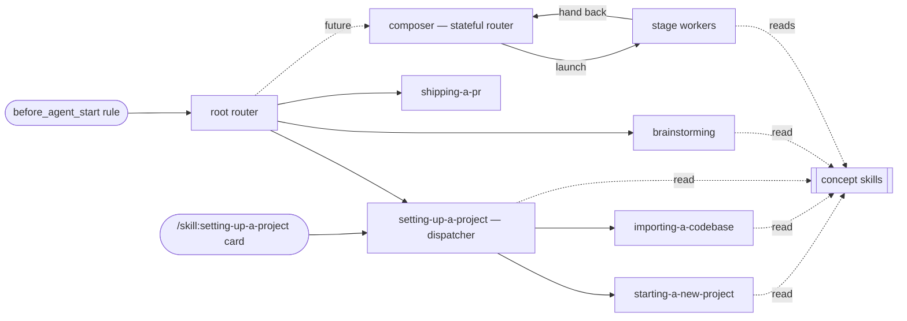

# skills/ —— 工作流家族及其元层

> 中文译文，原文见 [`SPEC.md`](./SPEC.md)。英文原文是唯一权威来源，二者不一致时以原文为准。

## 职责（Responsibility）

本目录是**工作流 skill 家族**：把 agent 应*如何运行一件工作*固化成规范的过程类 skill。
本规格是该家族的**元层** —— 概念模型、三种 skill 角色，以及治理此处每个工作流 skill 的元规则。
它是权威的 *why*；`writing-workflow-skills` skill 承载可执行的撰写检查清单并回指此处
（它引用的“(rule N)”即下面的元规则）。打包、交付与包边界位于父节点
[[module-thinkrail-workflow]]。

溯源：设计出自（此后已退役的）workflow-system task-spec，调研依据为
obra/superpowers、gsd-build/gsd-2、Anthropic 的 skill 撰写指南，以及 JetBrains/thinkrail-v1 ——
后者的工作流是未来可能出现的复杂工作流的一个*示例*，而非模板。

## 概念模型（Concept model）

- **工作流** —— 一种可重复的运行一件工作的方式，固化成一个或多个 skill。
- **工作流 skill** —— 一个 skill = 一个*外部可达*的工作流*或一个共享概念*；
  简短、祈使式、聚焦工作流。
- **同级文档（sibling doc）** —— 与某个 skill 的 `SKILL.md` 并列的文件，承载工作流的一个内部节点
  （一个分支、阶段或共享尾段）或参考细节；在交接给它的确切步骤中具名，按需读取，
  自身永不可被发现（规则 1 与 3）。
- **概念** —— 某个主题的可复用规则、约定或心智模型 —— 过程类 skill 所立足的共享地基，
  当多于一个 skill 需要它时，固化成一个自己的 skill。
- **交接** —— 工作流 skill 结尾处按名进行的显式转移，或一个已宣告的终止状态。
- **门禁** —— 一个硬性纪律点（例如“设计获批之前不做实现”），连带反合理化注记一起写出，
  而不是软性建议。
- **产物** —— **规格树**（持久记录：决策、契约、限制、原则 —— 代码无法揭示的一切）与
  **临时文档**（一件工作的脚手架：一份 task-spec 和/或工作流宣告的工作文件），由规则 8–9 治理。
  这个划分是*生命周期*上的，而非文件类型上的 —— task-spec 在存活期间住在图谱内（规格工具），
  但它仍是临时文档。临时文档也有一个指定的*家*：工作区里被 gitignore 的 `.thinkrail/context/`
  （按 worktree 由宿主播种，零 git 足迹，仍被规格工具扫描），因此它们对 agent 是活的，
  却永不进入提交树 —— 持久内容就地落在规格树里（规则 8）。

## skill 角色与交接契约（Skill roles & handoff contracts）

每个工作流 skill 恰好承担**三种角色**之一；更丰富的一切都是由它们搭成的*模式*。

| Role | Body contains | Ends by |
|---|---|---|
| **Router** | classification rules + handoffs only | naming what runs next |
| **Worker** | one workflow's steps — in its body and its sibling docs | a handoff — fixed successor, back to its caller, or a terminal state (declared in the doc where the flow ends, rule 6) |
| **Concept** | one topic's reusable rules, conventions, or mental model — no steps, no routing | nothing — no ending section at all; control simply returns to its reader |

**根路由器**是新工作流合格工作的单一入口；一条常开规则列举这些类别并把它们指向它。已路由的工作
恢复其活动工作流，而不是重新进入路由器。分支 skill 可继续路由（分形路由）。
**概念**不是过程的构件 —— 路由器与 worker 在需要它的确切步骤中按名点到它，而它永不成为一条路由：
路由器分类*工作*，概念不是工作。

**模式**（词汇，而非角色 —— 目前尚无实例；用于复杂工作）：

- **组合器（Composer）** —— 一个*有状态的路由器*：与用户就一项按任务的流水线达成一致，把它记录在
  task-spec 的**Pipeline 章节**中（复选框 = 计划 + 前沿 + 历史），并走这条流水线，随发现落地而调整；
  它启动的 worker 交回给它。其阶段之间的检查纪律是它自己的设计，不是系统规则。家族可以容纳多个
  组合器，共用同一个阶段池。
- **阶段（Stage）** —— 任何从流水线到达的 worker：上游产物进，一份产物出，交回其调用方。
  同一个 worker 也能独立运行（固定后继/终止交接）—— 阶段性是 worker 被*使用*的方式，
  而非它*是*什么。

没有运行时机械 —— 本系统只有 skill（没有 YAML 流水线、DAG 工具或阶段会话）：流水线状态是 task-spec
内容；阶段转移是普通的交接。

## 元规则（Meta-rules）

**结构（Structure）**
1. 每个 skill 一个*外部可达*单元 —— 一个工作流若只被当作整体触达（被路由到、被另一个 skill 调用，
   或自行触发），它就是一个 skill；每个概念 skill 一个主题。
   **skill 边界遵循外部可达性，而非工作流形态**：工作流的内部形态 —— 分叉、分支、阶段、汇合、
   修订循环 —— 住在同级文档里，*选择规则留在分叉之前的文档（或主干）中*。当内部文档需要
   *独立可寻址性* —— 一个外部调用方（另一个 skill 或路由器）、真正的自触发，或直接入口
   （一个 UI / `/skill:` 命令种子）—— 它才被提升为自己的 skill：当父节点之外的东西必须直接触达它时，
   单一消费者就足以证成一个 skill。绝不只为形态或体量而提升。
2. 路由器负责路由；worker 负责干活；概念负责告知。路由器只包含分类规则 + 交接 —— 绝不含某个分支的步骤；
   为*分类*而提问或检视工作区属于路由，不是工作。worker 除自身结尾之外不嵌入*工作*的路由 ——
   其自身同级文档之间的分叉（规则 1）属于内部流程，不是路由。概念 skill 不含步骤也不含交接；
   它可以陈述关于其主题的规范，但*何时*执行它们属于引用它的过程类 skill。
3. skill 简洁且聚焦工作流：目标每文件 < ~150 行 —— `SKILL.md` 主干与每份同级文档皆然。同级文档承载
   工作流的内部节点（规则 1）以及参考细节，在交接给它们的确切步骤中具名（渐进式披露）；
   主干承载文档地图，每份内部节点文档以一行契约开头：进入时已确认什么、保存了什么、控制权接下来去哪。
   *第二个 skill* 需要的规则被抽取成概念 skill —— 不做过早抽取；在一个 skill 的文档内，
   共享内容住在一份文档里，由其他文档指向它。

**发现与入口（Discovery & entry）**
4. 在一件新工作的开始时，一条常开入口规则列举符合工作流条件的类别 —— 无论是否修改代码，
   项目上手与 PR 生命周期类工作都优先；对产品行为的其他每一处改动 —— 一个特性、一处行为变更或
   一个缺陷修复，无论多小 —— 也进入。只有非 PR 的提问、解释与检查，以及不改变行为的编辑
   （拼写、仅文档或配置、机械式重构）可直接进行。该规则只把符合条件的类别指向根路由器。
   已路由的工作恢复其活动工作流；其他一切工作直接进行，既不加载也不宣告工作流。
   除此之外，skill 通过路由/交接触达，或者 —— 当触发条件确凿无疑时 —— 通过狭窄的自触发 `description`：
   与某条路由并列（如 `setting-up-a-project` 之所为），或对处于路由器工作分类之外的 skill
   （元/撰写类 skill）单独自触发（如 `writing-workflow-skills` 之所为）。概念 skill 由需要它的
   那个 skill 步骤按名触达，并可增加一条狭窄的自触发；它们永不占用一条路由行
   （见角色表 —— 概念不是工作）。
5. `description` = 仅触发条件（“当……时使用”），绝不是对工作流步骤的摘要 ——
   步骤摘要会诱使 agent 照着描述行事而跳过正文。

**串联（Chaining）**
6. 显式结尾：每个过程类 skill 以点名其后继 skill 或终止状态结尾 —— 内部有分叉的 worker（规则 1）
   以点名延续流程的那份同级文档结尾，每份内部文档也以同样方式结尾（下一份文档、返回点，
   或终止状态 —— 在实际结束流程的那份文档中宣告）；概念 skill 没有下一步要运行，也不写结尾章节 ——
   控制权直接回到其读者。按名交叉引用 skill；绝不内联另一个 skill 的步骤，绝不强行加载另一个
   skill 的文件。
7. 每件事只说一次：一条规则或步骤只住在一个 skill 里；其他 skill 指向它。被多于一个 skill
   需要的规则被抽取成概念 skill 并被指向，绝不复制。

**产物（Artifacts）**
8. 规格树是唯一的持久记录；持久内容如何、何时到达其中由工作流自行决定 —— 随决策落定直接写入树中
   （完全不用临时文档）、随决策成形从 task-spec 增量提升，或在工作落地时提升。永不改变的是：
   持久内容在其临时文档被清理之前就已进入树中，且不存在并行的持久计划/状态格式。
9. 临时文档是可选的，且属于其工作流。使用时的默认主干是 task-spec —— 设计、计划、流水线状态与
   评审笔记作为其章节存在；额外的工作文件（续跑状态、草稿计划）通过指明其形态来声明。
   **所有临时文档都住在工作区被 gitignore 的 `.thinkrail/context/` 中**（按 worktree 由宿主播种 ——
   见 server 的 workspaces 模块 —— 因此它们永不进入提交树）。所属工作流也拥有清理权 ——
   默认在工作落地时删除；临时文档永不会变成记录。

**伸缩（Scaling）**
10. 靠路由与组合伸缩，而非靠散文：不需要工作流决策的工作绕过路由器；路由器把符合条件的简单工作
    送上短路径；可选阶段带有显式的“何时使用／何时跳过”标准；复杂工作组合出一条由阶段 worker
    构成的按任务流水线。深度存在于所走的那条路由里。
11. 在纪律要紧之处设门禁，并让形式匹配失败模式：纪律违规用禁令 + 红旗；输出形态用正向配方。

**维护（Maintenance）**
12. 新增一个工作流 = 新增 `skills/<name>/` + 在拥有它的路由器中加一条路由行 —— 默认是根路由器，
    或当该 skill 是某条已路由工作流下的分支时是最近的子路由器（分形路由）——（按规则 4，
    仅自触发的 skill 与概念 skill 跳过路由行 —— 这是设计上的例外，绝不是体量上的判断）
    + 在下文的家族表中加一行，包含其 **Routed from** 条目。其余一切形态不变。
13. 规格主导：改变系统形态的变更先更新本 SPEC.md；撰写 skill 只承载可执行的检查清单，
    并把理由指向此处。
14. 通过使用验证 —— **已暂停：一个已知限制，当前不是完成门禁**。原本的规则是：新增或变更的 skill
    只有在观察到真实请求流经它之后才算完成 —— 对概念而言，是观察到它通过某条引用（或其自触发）
    被加载并应用。**廉价的观测工具如今已存在**：无头 workflow-test 测试装置
    （[[module-workflow-tests]]）按 `defineScenario` 驱动真实 agent 穿过一个 skill，并记录每次运行。
    仍让该门禁暂停的是：运行只落在**被 gitignore 的本地日志**（`e2e/.workflow-runs.jsonl` ——
    一个有意的决策，不是意外）中，因此没有持久、共享的记录可供绑定完成门禁。在此之前：
    未验证的 skill 仍以 `active` 发布，其验证欠账诚实地记录在家族表中（`unverified by use`），
    而观察到的运行 —— 手工或测试装置 —— 在发生时仍会被记下。

**命名（Naming）**
15. 名称以动词开头、主动语态、kebab-case（采纳自 obra/superpowers 的 writing-skills 指南）：
    过程类 skill 用动名词（`choosing-a-workflow`、`setting-up-a-project`）；概念 skill 以其主题命名
    （`asking-user-questions`）。命名该 skill 所运行的工作或它所承载的洞见 —— 绝不是它产出的产物
    或运行它的角色。目录名 = frontmatter 中的 `name`。

## 工作流家族（Workflow family）

| Skill | Role — purpose | Routed from | Status |
|---|---|---|---|
| `brainstorming` | worker —— 特性、行为变更或缺陷修复 → 访谈式设计（先产品，后技术）→ 修订规格 → 实现；同级文档 `fixing-a-bug.md`（缺陷分支）与 `amending-specs.md`（共享尾段） | `choosing-a-workflow`（根） | active；默认入口的路由进入 —— 一处小的已成规格的变更，以及一个不编辑源码就到达缺陷分支的缺陷报告 —— 由路由套件观测为通过（2026-10），流程中段的往返亦然；两阶段访谈与自驱的规格修订未通过使用验证 |
| `setting-up-a-project` | router（子）—— 调度器：探测工作区的状态（有规格／空／仅代码）并路由 | `choosing-a-workflow`（根）+ 自触发 + 应用的 `/skill:setting-up-a-project` 种子 | active；空 → starting 与代码 → importing 被观测为通过；修订后的“已有规格 → 评审/扩展”提议未通过使用验证 |
| `starting-a-new-project` | worker —— 立项访谈（空仓库 → goal-and-requirements） | `setting-up-a-project` + 狭窄自触发 | active；路由进入由路由套件观测；访谈本身及其活文档模板（2026-09）未通过使用验证（规则 14 已暂停 —— 一个经由用户模拟器的第 3 切片候选） |
| `importing-a-codebase` | worker —— 现有代码库 → 首张规格图谱（推导 + 采纳既有文档 + 最小访谈） | `setting-up-a-project` + 狭窄自触发 | active；由带标签的 `@agent` e2e 覆盖；路由进入亦由路由套件观测；文档采纳提议由测试装置的 importing 套件观测为通过（2026-07：采纳 + 无候选回归场景；变更前的 skill 在同一场景下作为前/后对照跑红）；理由（“why”）与已知限制相关提问未通过使用验证（在其落地后 importing 套件仍为通过，2026-10，但并未断言它们） |
| `asking-user-questions` | 概念 —— 多轮访谈（设计树／前沿）、问题质量、选项、推断确认、降级 | ——（按名触达，规则 4） | active；多轮访谈模型未通过使用验证；更早的单轮规范曾被观测（2026-07 手工：经由 brainstorming 的引用加载，组合并解决了一轮） |
| `writing-specs` | 概念 —— 每个产出规格的流程所遵循的规格质量线（短／诚实／不脱轨） | ——（按名触达，规则 4） | active；经使用而观测（2026-07 手工：为一次规格修订自行触发并被应用） |
| `choosing-a-workflow` | router（根）—— 对符合工作流条件的工作进行分类 + 路由 | ——（来自常开规则的条件性指针，规则 4） | active；每一次分类，包括小型行为变更与缺陷报告的默认入口，均由路由套件观测为通过（2026-10） |
| `writing-workflow-skills` | worker —— 新增工作流的撰写检查清单 | ——（仅自触发，规则 4） | active |
| `shipping-a-pr` | worker —— PR 生命周期（带门禁的创建／正文或截图维护／与上游同步／检查／评审意见 —— 各阶段为同级文档） | `choosing-a-workflow`（根）+ 狭窄自触发 | active；默认快照式完成与验证复用未通过使用验证（规则 14 已暂停） |

家族是开放的，并从真实使用中生长；候选者（研究/spike、重构、一个按组合器模式构成的组合 skill
及其阶段 worker，以及**扩展现有规格图谱** —— 调度器已接受的评审/扩展提议，今天是一条已宣告的
无工作流路径）各自在赢得其位置时获得自己的 task-spec。概念角色有两个实例：`asking-user-questions`
（按规则 3/7 抽取，当时 brainstorming 与 setup 三件套携带了漂移的工具规范副本）与 `writing-specs`
（以同样方式抽取，当时 setup 三件套携带了三份漂移的规格质量线副本）。
`asking-user-questions` 在**多轮前沿**中访谈，改编自 mattpocock/skills 的 `grilling`：旧规范
（“只有当答案引出真正的新问题时才开新一轮”）加上工具 prompt 的“一次调用问完所有问题”被读成了
一次到底，于是 agent 问得太少。采纳：设计树／前沿、不设上限的一轮、查事实而不是问事实、
一条问题质量线。经用户决策否决：一个单独按需启用的 “grill me” skill（深度住在共享规范里，
因此每个工作流都得到它）与 grilling 的“确认共识理解”门禁（空前沿直接前进；
每个工作流自己的门禁仍然生效）。
元规则 4 的入口模型已生效：在新工作开始时，父模块的 `before_agent_start` 规则把符合工作流条件的
工作指向 `choosing-a-workflow`，它路由到今天这个家族；已路由的工作恢复，直接工作绕过路由器。
`writing-workflow-skills`（仅自触发）与概念 skill（按名触达）位于路由表之外。

## 当前限制与缺口（Current limitations & gaps）

家族已知的欠账，按其自身的诚实线陈述，并在每项赢得修复之前在此跟踪：

- **规则 14（通过使用验证）已暂停** —— 当前不是完成门禁。上面的规则载有完整理由（观测如今很廉价；
  缺失的那一半是持久的运行记录）；家族表载有当前每个 skill 的 `unverified by use` 欠账。
  第 3 切片 —— 通过用户模拟器的 worker 流程（[[module-thinkrail-workflow]] § Testing）——
  会烧掉 worker 流程的欠账；变更后的路由行为在匹配场景被观测前仍未验证。
- **扩展现有规格图谱没有 worker。** 部分图谱 → 完整图谱（缺失的 `architecture.md`、
  尚未成规格的模块、陈旧节点）落在两个 setup worker 之间：`importing-a-codebase` 拒绝已带规格的
  仓库，`brainstorming` 设计新工作而非记录既有现实，而调度器 —— 一个路由器 —— 不得自己干这些活。
  调度器只载有操作性指令（其 “Graph extension” 章节）：在无路由宣告的情况下就判断向用户的请求对齐，
  持有 `writing-specs` 的质量线 —— 理由住在这里，不在 skill 里 —— 直到 `extending-a-spec-graph`
  候选赢得其位置。
- **`writing-specs` 与规格图谱 skill 重叠**（[[module-spec-graph]]）：今天两者都载有精简/诚实的
  规格指导。已宣告的分工 —— 本家族拥有质量线，规格图谱拥有图谱机制（frontmatter、链接、工具）——
  仅是约定，无任何东西强制。随着 `writing-specs` 成长为家族关于规格与规格图谱规则的家，
  规格图谱 skill 的指导应瘦身到机制 —— 否则抽取所修复的那处漂移会从上一个包层回来。
- **家族的大多数候选尚未构建**（上文的候选清单）—— 这是有意的，因为每一项都要通过真实使用
  赢得其位置。在此之前，每一次行为变更都进入 `brainstorming`，而无行为变更的工作直接进行；
  未来的组合器可能拥有多阶段流水线。
- **设计是整体批准的，而不是逐节批准。** 边起草边确认每一节会让用户成为设计的共同作者，
  但它需要一个用于提议的规格章节的应用内评审界面，而 UI 还没有。在它出现之前，
  产品阶段的检查点与单次设计评审代替它。

## 每个 skill 的设计笔记（Per-skill design notes）

每个工作流的步骤只写一次，在其自己的 `SKILL.md` 中 —— 权威措辞。每个 skill 正文还载有自己的
降级行为（没有 `ask_user_question` 工具的会话、对它没有 UI 的无头宿主、被跳过或被拒绝的回答、
没有既有规格图谱的工作区）；此处不配置任何东西。以下只是 skill 正文未陈述的理由：

- **`brainstorming`** 把本仓库自我要求的纪律（“规格先于代码”）应用到产品行为的每一次改动：
  请求 → 在规格图谱 `task-spec` 中访谈式成型的设计 → 修订持久规格 → 实现。它是新特性、行为变更或
  缺陷修复的默认入口，无论多小；只有不改变行为的工作绕过它。这个默认之所以存在，是因为用户看重
  在有任何东西被构建之前先被质疑 —— 访谈要求很高，但正是它使最终规格被理解并被信任。
  一个由 agent 自行判断的门禁（“这是否已被规格覆盖？”）让大多数工作跳过了访谈与规格更新，
  图谱便随时间与代码漂移。深度随变更伸缩，且从不降为零：小的变更得到一轮简短访谈和几行 task-spec。
  访谈分两阶段运行 —— **先产品**（为什么、给谁、用户会看到什么、我们如何知道它完成了），
  然后**技术**（方法、约束、验证）—— 二者之间有一个检查点，在任何技术选择做出之前确认产品理解。
  请求中明确的回答不会被再问，明确的设计或验收标准仍算作批准。agent 考虑过并否决的替代方案 ——
  尤其是代码住在哪里（server 还是 browser，契约还是展示）—— 连同其权衡一起展示，绝不默默决定：
  一个由 agent 自行判断的可行性门禁曾让它选中用户从未见过的方案。刻意不另设一份计划产物；
  规格就是计划。
  开放的用户决策通过 `asking-user-questions` 分轮访谈，直到没有任何一项仍属假设。
  **缺陷**走 `fixing-a-bug.md` 分支：缺陷是记录意图与行为之间的缺口，因此该分支先分类规格怎么说 ——
  沉默、错误、正确而只有代码错，或者这个“缺陷”其实是新特性（回到主流程）—— 并在代码之前
  把预期行为在 task-spec 中定下来。像每一次变更一样，持久规格在构建之后被修订，于是它记录所构建之物；
  task-spec 才是引领修复的东西。
  **规格修订**（`amending-specs.md`，两条路径的共享尾段）是 agent 自己的工作，不是一轮用户批准 ——
  经用户决策：它自上而下工作（目标 → 架构 → 模块），然后把结果与实际构建之物对照检查，
  并用一两行报告；Changes 评审是用户看到 diff 的地方。它先加载 `writing-specs`。
- **`setting-up-a-project` 三件套**随 Welcome 屏的工作到来（当时名为 `project-setup` /
  `project-new` / `project-import`；按规则 15 重命名），并就地适配到本系统。
  `setting-up-a-project` 是一个**子路由器**（调度器）：它检视工作区以分类（有规格／空／仅代码）——
  按规则 2，这是路由，不是工作 —— 并从根路由器、自触发，以及应用 “Set up project” 卡片的
  `/skill:setting-up-a-project` 种子触达：这个直接入口按规则 1 的可寻址性检验证成了它的 skill 资格
  （`starting-a-new-project` / `importing-a-codebase` 同样是单一消费者 skill，在情境明确无疑时
  由直接可达性证成）。`starting-a-new-project` 提炼自旧 thinkrail 的 `new-project` 移植 ——
  工作模型推断、个人 vs PRD 的路由、MVP 优先的启发、替代方案调研、增量保存；看板/进度跟踪器机制
  被丢弃（此处无对应物）。`importing-a-codebase`（净新）从代码 + agent 文件中逆向工程出首张规格图谱，
  只就代码无法揭示的意图进行访谈。那份意图总是包含每个非显然决策背后的 *why* 与已知限制：
  没有它们，规格记录代码做了什么，却不记录后续变更必须保留什么，因此访谈会问它们
  （把推断出的答案提出以供纠正），而不是把理由留给偶然。它的文档采纳提议（2026-07）之所以存在，
  是因为文档写得很好却没有规格的仓库在导入时正在失去自己的文档：持久的声明性文档（绝不是计划或
  过程文件）在访谈轮中被提议，并被**就地**采纳 —— 只加 frontmatter，于是“只说一次”成立、
  用户的话仍归用户、diff 在 Changes 中可评审 —— 而不是蒸馏进会漂移的平行节点里；
  被采纳的散文只在含混或已与代码漂移之处被纠正，且每处纠正都会向用户标记。适配触点刻意最小：
  描述裁剪到触发条件（规则 5），内联的问题规范替换为指向 `asking-user-questions` 的指针（规则 7），
  结尾变得显式（规则 6），漂移的规格质量线副本后来被抽取进 `writing-specs`（规则 3/7）——
  流程本身未被触动。
  `starting-a-new-project` 的保存形态后来被修订（2026-09）：V1 功能与 MVP 范围（`In v1` /
  `Out of v1`）章节让位于 Capabilities + Non-goals，而定稿时翻转 `draft → active` 而不是 `done`。
  按版本切分的目标文档在工作发布的那一刻就陈旧了：ThinkRail 自己的 V1/V2 目标文档累积了
  “ships in V1 as …” 式的例外条款，而 agent 把它的 “not in V1” 清单读成对正在构建之工作的禁令。
  MVP 纪律作为启发式存活（最小有用的首次构建）；被砍掉的东西回到用户那里，而不是进入一份
  “以后再说的清单”。
- **`asking-user-questions`** 一次性承载家族的 `ask_user_question` 规范：轮次、选项设计、
  推断确认模式，以及各种降级：被跳过的一轮、一个无头宿主，以及一个没有该工具的会话
  （扩展被关掉，或从未安装），此时这一轮以普通聊天消息发出，轮次结束以等待。调用方保留*何时* ——
  并说明假设记录在哪里。
- **`shipping-a-pr`** 从操作者真实的 PR 会话中挖掘而来（2026-06→08：扫描 125 次，36 次含 PR 工作）：
  反复出现的请求 —— 先验证再开 PR、先自审、在最新的 main 上 rebase、UI 变更要截图、
  “make PR up-to-date”、“look at the checks”、“do not fix review comments blindly” ——
  成为它的门禁与阶段文档。一个 skill 而不是五个（规则 1）：每一次生命周期请求都经同一个触发进入；
  各阶段是作为同级文档的内部叉。创建时仓库的 PR 模板拥有正文章节、顺序与检查清单；
  通用的 Summary/Changes/Testing 形态只是无模板时的回退。完成模式跟随用户请求的结果，
  而不是该阶段是否推送 PR head。普通的创建、同步、head 更新、元数据维护与一次性状态请求
  只取一份新的检查 + 合并状态快照然后停止；只有明确的远端完成请求进入等待模式。本地验证是证据感知的：
  已针对最终变更运行过的精确检查被复用，而缺失或已失效的门禁在后来的编辑、相关依赖或基线变更、
  冲突解决之后重跑。证据必须在每一次影响代码的推送前覆盖最终树，因此验证或自审的修复会循环
  经过重新评估。配置了 CI 时，CI 是最终的全量验证层。等待模式的合并就绪仍然显式：`CLEAN` 成功；
  `HAS_HOOKS` 成功但带 pre-receive hooks 的保留意见；`UNKNOWN` 轮询；`BEHIND`/`DIRTY` 同步；
  `BLOCKED`/`UNSTABLE` 保持非肯定，并报告 `reviewDecision`。草稿状态单独读取，永不称作合并就绪。
  空的检查汇总是不确定的；无 CI 仓库只有在该缺失被独立确认之后才报告。这避免了重复有效的开发期检查，
  也避免把例行的 PR 交付变成未经请求的 CI 监视，同时在请求承诺之处保留合并就绪的门槛。
  仅评审用的 assets-ref 截图默认值是一个明确的用户决策（task-spec `task-shipping-a-pr-skill`）。
  它的评审加固（PR #284）收敛到一条共享纪律，而不是逐个发现的补丁 —— **观测，绝不假设**：
  三轮评审中的每一个发现都是同一个缺陷（依据、或宣告，在行动那一刻并未观测到的状态），
  因此该规则只在主干中住一次 —— 在行动点验证、新鲜且完整地拉取远端状态、轮询不确定的答案 ——
  而每个阶段文档在自己的行动点上实例化它（树变更步骤之后的推送前重断言，重新拉取标题/正文
  并把请求的变更重新应用到新值，轮询 `UNKNOWN` 合并状态，丢弃物的清理由制造该丢弃物的阶段拥有）。
- **`writing-specs`** 一次性承载家族的规格质量线 —— 短／诚实／不脱轨 —— 并且是家族关于规格与
  规格图谱的规则随其增长而不断累积的家。图谱*机制*（frontmatter、链接种类、`spec_*` 工具）
  留在规格图谱 skill（[[module-spec-graph]]）里；本概念是工作流在其之上持有的那条质量线。
  按规则 3/7 抽取，当时 setup 三件套携带了三份漂移的质量线副本（而调度器 —— 一个路由器 ——
  按规则 2 携带了它不该携带的规范）。目标文档的形态（一份活的、不带版本或路线图的产品记录）
  住在这里，不在任何一个 setup worker 中，因为二者都起草图谱根。
